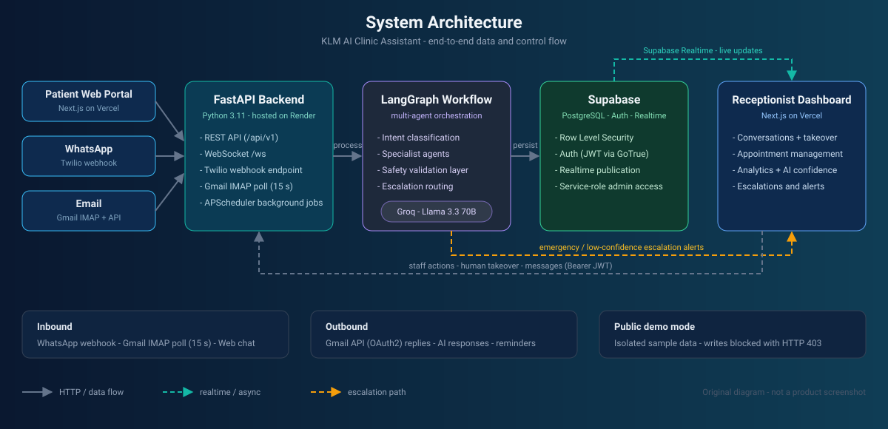
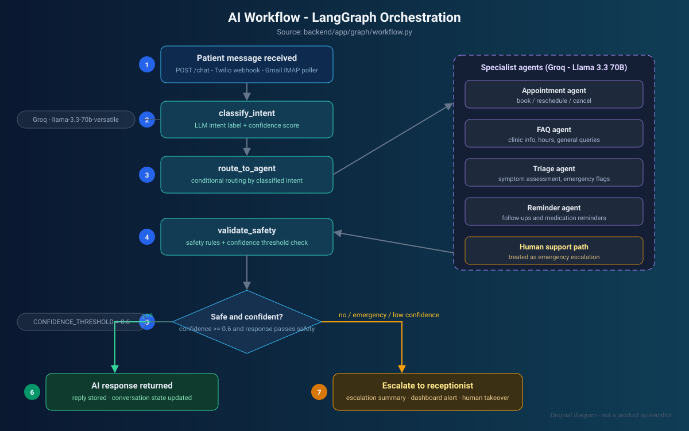

<div align="center">


# 🏥 KLM AI Clinic Assistant

**An AI-powered clinic operations platform that automates patient communication, appointment workflows, and receptionist operations through intelligent multi-agent orchestration.**

[](LICENSE)
[](https://nextjs.org/)
[](https://react.dev/)
[](https://fastapi.tiangolo.com/)
[](https://www.python.org/)
[](https://langchain-ai.github.io/langgraph/)
[](https://groq.com/)
[](https://supabase.com/)
[](#-testing--quality)

**[🌐 Live Frontend](https://clinic-ai-assistant-one.vercel.app/)** ·
**[⚙️ Backend API](https://clinic-ai-backend-t38f.onrender.com/)** ·
**[📚 API Docs](https://clinic-ai-backend-t38f.onrender.com/docs)** ·
**[🎮 Demo Login](#-public-demo-login)**

</div>

---

## 📑 Contents

- [Project Status](#-project-status)
- [Public Demo Login](#-public-demo-login)
- [Problem Statement](#-problem-statement)
- [Key Features](#-key-features)
- [Screenshots](#%EF%B8%8F-screenshots)
- [Technology Stack](#%EF%B8%8F-technology-stack)
- [System Architecture](#%EF%B8%8F-system-architecture)
- [AI Workflow](#-ai-workflow)
- [Installation Guide](#-installation-guide)
- [Environment Variables](#-environment-variables)
- [Database Setup & Migrations](#%EF%B8%8F-database-setup--migrations)
- [Deployment Guide](#-deployment-guide)
- [API Documentation](#-api-documentation)
- [Security](#-security)
- [Testing & Quality](#-testing--quality)
- [Repository Structure](#-repository-structure)
- [Roadmap](#%EF%B8%8F-roadmap)
- [Author](#-author)

---

## 📌 Project Status

This project is **fully implemented and locally verified**. The frontend is deployed and live. The backend is deployed on Render but is **currently returning HTTP 503** while Supabase credentials are being reconfigured (see [Deployment Guide](#-deployment-guide)).

| Layer | Status |
|---|---|
| Next.js frontend (Vercel) | 🟢 **Deployed & live** — [clinic-ai-assistant-one.vercel.app](https://clinic-ai-assistant-one.vercel.app/) |
| FastAPI backend (Render) | 🟡 **Deployed** — currently HTTP 503; pending Supabase `SUPABASE_SERVICE_ROLE_KEY` configuration |
| Supabase database & auth | 🟡 Schema + 7 migrations committed to the repo; production state not verifiable from this machine |
| Public demo login | 🟢 **Implemented & locally verified** (20 backend tests) — live verification pending backend fix |
| Local test suites | 🟢 **29 tests passing** + clean type-check, lint, and production build (verified Nov 2026) |
| WhatsApp / Gmail / Twilio integrations | 🟠 Implemented in code — require owner credentials (`TWILIO_*`, `GOOGLE_*`, `IMAP_*`) to activate |

> ℹ️ **Transparency note:** all diagrams in this README are original illustrations created for this project — they are not screenshots of the running application. Screenshot placeholders are marked in the [Screenshots](#%EF%B8%8F-screenshots) section.

---

## 🎮 Public Demo Login

Every visitor can explore the **receptionist dashboard** with isolated sample data:

> **🌐 Demo URL:** <https://clinic-ai-assistant-one.vercel.app/login>

| Field | Value |
|---|---|
| Email | `demo@gmail.com` |
| Password | `demo123` |

The login page displays these credentials and a **Login as Demo User** button that auto-submits the real login request — there is no fake, frontend-only session.

### How the demo works

- **Real authentication.** The demo signs in through `POST /api/v1/auth/login`, which calls **Supabase Auth (GoTrue)** and returns a genuine access token. The demo account is a real Supabase Auth user with the `receptionist` role.
- **Fictional sample data only.** Demo read endpoints never query production tables — they return deterministic, fictional sample data served by `backend/app/demo/data.py` (conversations, appointments, escalations, analytics, doctors, notifications).
- **Server-side write protection.** Demo write operations (takeover, resume AI, appointment changes, staff messages, profile edits, …) are rejected with **HTTP 403** by the backend guard `get_staff_user_for_write` / `reject_demo` — not merely hidden in the UI.
- **Idempotent provisioning.** On startup the backend signs in with the demo credentials first and only repairs the password if sign-in fails — it does **not** reset the password on every restart.
- **Isolation from real patients.** The demo account has its own `users` row with `is_demo = TRUE` and shares no rows with real patient or staff data. It is intentionally public and must never contain real patient information.
- **Optional in-memory simulation.** A few harmless dashboard actions are simulated in memory only; nothing external (email, WhatsApp, database) is touched.

Disable the demo in production with `DEMO_MODE_ENABLED=false`.

---

## ❗ Problem Statement

Small clinics run their front desk on manual effort — and patients feel it:

| Problem | Impact |
|---|---|
| 📱 Manual patient communication | Staff answer the same hours/location/insurance questions all day across WhatsApp, email, and phone |
| 📅 Appointment scheduling overhead | Every booking, reschedule, and cancellation consumes receptionist time and is error-prone |
| ⏱️ Delayed responses to inquiries | Patients wait hours (or until the next morning) for simple answers |
| 🔀 Fragmented channels | WhatsApp, email, and web chats live in separate inboxes with no shared context |
| 🚨 Missed emergency messages | Urgent symptoms can sit unread in a busy inbox — a genuine patient-safety risk |
| 👩‍💼 Receptionist overload | The front desk juggles triage, scheduling, and follow-ups with no prioritization |
| 👁️ No centralized visibility | Managers cannot see AI performance, channel mix, or conversation history in one place |

**How this project addresses them:** every inbound message — web chat, WhatsApp webhook, or polled email — flows through a **LangGraph multi-agent workflow** that classifies intent, answers routine questions via **Groq (Llama 3.3 70B)**, books appointments against real doctor availability, and **automatically escalates emergencies and low-confidence cases to human staff** on a real-time receptionist dashboard with one-click takeover.

---

## ✨ Key Features

### 👤 Patient Experience
- **Omnichannel intake** — web chat, WhatsApp (Twilio webhook), and email (Gmail IMAP polling every 15 s + Gmail API outbound replies)
- **Appointment booking** — checks real doctor schedules, leaves, holidays, and blocked slots before offering a slot
- **Medical FAQ agent** — answers clinic hours, address, and services questions from configured clinic info
- **Symptom triage** — intent-routed triage agent with emergency detection
- **Patient portal** — dedicated Next.js portal: appointments, messages, notifications, medication reminders, profile
- **Notification center** — per-user notifications with unread counts and mark-as-read

### 👩‍💼 Receptionist Dashboard
- **Live conversation feed** — all patient conversations ordered by latest activity, with message history and timelines
- **AI confidence tracking** — every AI response carries an intent label and confidence score
- **Human takeover** — one-click `takeover` / `resume-ai` switch with staff messaging and full timeline logging
- **Escalation queue** — emergency, safety-violation, and low-confidence cases raised as dashboard alerts
- **Appointment management** — status updates, doctor availability views
- **Analytics** — dashboard stats, intent distribution, channel mix, message volume, doctor utilization, CSV export
- **Audit trail** — activity log records system and user actions

### 🧠 AI Intelligence
- **LangGraph orchestration** — `classify_intent → run_agent → validate_safety → (escalate | end)`
- **Intent classification** — booking, reschedule, cancel, FAQ, symptom, reminder, follow-up, human support
- **Specialized agents** — appointment, FAQ, triage, reminder, escalation agents on Groq `llama-3.3-70b-versatile`
- **Safety validation layer** — checks generated responses before delivery; unsafe responses replaced with a safe fallback
- **Emergency escalation logic** — emergency keywords and human-support requests bypass normal flow
- **Human-in-the-loop** — receptionists can take over any conversation mid-stream and hand it back

### 🎮 Demo Mode
- Public one-click demo login through real Supabase Auth
- Deterministic fictional sample data across every dashboard view
- Server-enforced read-only access (HTTP 403 on writes)
- Idempotent provisioning, no external side effects, isolated from real data

---

## 🖼️ Screenshots

> ⚠️ **Placeholder — no fabricated screenshots.** Genuine screenshots of the login page, receptionist dashboard, conversations, appointments, analytics, and patient portal will be captured from the running application and added here once the backend is live again. The diagrams in the [System Architecture](#%EF%B8%8F-system-architecture) and [AI Workflow](#-ai-workflow) sections are original illustrations, clearly labeled as such.

| | |
|:---:|:---:|
| *Login page — placeholder* | *Receptionist dashboard — placeholder* |
| *Conversations — placeholder* | *Analytics — placeholder* |

---

## 🛠️ Technology Stack

<div align="center">

**Frontend**


**Backend**


**AI**


**Database**


**Integrations & Deployment**


</div>

### Version details (verified from `requirements.txt` / `package.json`)

| Layer | Technology | Version | Purpose |
|---|---|---|---|
| Frontend | Next.js (App Router) | `^15.5.19` | Pages, middleware auth guard, API rewrites |
| Frontend | React + TypeScript | `^19.2.7` / `5.8.2` | UI & type safety |
| Frontend | Tailwind CSS | `^4` | Styling |
| Frontend | TanStack Query | `^5.101.2` | Data fetching, caching, persistence |
| Frontend | Zustand | `^5.0.14` | Client state |
| Frontend | Recharts / Framer Motion / Sonner | `^3.9` / `^12.42` / `^2.0` | Charts, animation, toasts |
| Backend | FastAPI + Uvicorn | `0.115.5` / `0.32.1` | REST API, WebSocket, GZip, CORS |
| Backend | Pydantic / pydantic-settings | `2.14.3` / `2.7.0` | Schemas & typed settings |
| AI | LangGraph / LangChain Core / langchain-groq | `0.2.60` / `0.3.29` / `0.2.3` | Workflow graph & LLM access |
| Database | supabase-py | `>=2.34.1` | Auth admin, PostgreSQL, Realtime |
| Integrations | Twilio / IMAPClient / google-api-python-client / APScheduler | `9.4.4` / `3.0.1` / `2.112.0` / `3.10.4` | WhatsApp, email in/out, schedulers |

> **Note:** the UI is built with Tailwind CSS and hand-rolled components (plus `lucide-react` / `react-icons`). Shadcn UI is **not** used — earlier README versions overstated this.

---

## 🏗️ System Architecture



**How a message flows:**

1. The patient writes via the **web portal**, **WhatsApp** (Twilio webhook → `POST /api/v1/webhooks/twilio`), or **email** (Gmail IMAP polled every 15 s by APScheduler).
2. The **FastAPI backend** (Render) authenticates the caller, persists the conversation, and runs the message through the **LangGraph workflow**.
3. The workflow calls **Groq (Llama 3.3 70B)** through LangChain and persists results into **Supabase PostgreSQL** (with Row Level Security).
4. **Supabase Realtime** and a **WebSocket `/ws` channel** push live updates to the **Receptionist Dashboard** (Next.js on Vercel).
5. Staff act from the dashboard — takeover, staff messages, appointment updates — each request carrying a **Supabase Auth JWT** validated by the backend.

---

## 🤖 AI Workflow



The workflow is a compiled LangGraph `StateGraph` (singleton in `backend/app/graph/workflow.py`):

| Step | Node | What happens |
|---|---|---|
| 1 | *Message intake* | Message arrives from `POST /api/v1/chat`, the Twilio webhook, or the IMAP email poller → `process_message()` initializes the graph state (message, channel, patient metadata). |
| 2 | `classify_intent` | LLM classifies the message into an `IntentType` (book/reschedule/cancel appointment, FAQ, symptom query, reminder, follow-up, human support) with a **confidence score**. Errors default to `HUMAN_SUPPORT` with confidence 0. |
| 3 | `run_agent` | Conditional routing sends the message to the matching specialist agent — appointment, FAQ, triage, reminder, or the escalation path. Human-support requests are treated as emergency escalations. |
| 4 | `validate_safety` | If `confidence < CONFIDENCE_THRESHOLD (0.6)` the response is replaced with an escalation reply. Otherwise the safety layer validates the drafted response; failures swap in a safe fallback. |
| 5 | *Conditional edge* | `should_escalate()` routes to `escalate` or `END`. |
| 6 | *Response* | Safe, confident replies are returned and the conversation state is updated. |
| 7 | `escalate` | The escalation agent writes a summary; the case appears on the receptionist dashboard for **human takeover**. |

---

## 🚀 Installation Guide

### Prerequisites
- Python **3.11** (repo pins `3.11.9` in `.python-version` / `runtime.txt`)
- Node.js 18+ and npm
- A Supabase project URL + keys and a Groq API key (see [Environment Variables](#-environment-variables))

### 1. Backend

```bash
cd backend
python -m venv venv
```

Activate the virtual environment:

```powershell
# Windows (PowerShell)
venv\Scripts\Activate.ps1
```

```bash
# macOS / Linux
source venv/bin/activate
```

Install dependencies and configure environment:

```bash
pip install -r requirements.txt
cp .env.example .env   # then fill in SUPABASE_*, GROQ_API_KEY, SECRET_KEY
```

Run the API:

```bash
uvicorn app.main:app --reload --port 8001
```

- API: <http://localhost:8001> · Swagger docs: <http://localhost:8001/docs>
- On startup the backend starts the Gmail IMAP poller and (if `DEMO_MODE_ENABLED=true`) provisions the demo account idempotently.
- ⚠️ A valid Supabase config is required even locally — some modules create their Supabase client at import time.

### 2. Frontend

```bash
cd frontend
npm install
cp env.example .env.local   # set NEXT_PUBLIC_API_URL=http://localhost:8001/api/v1
npm run dev
```

- App: <http://localhost:3000> (the backend CORS list in `backend/app/main.py` already allows `localhost:3000`–`3003`).
- In development, unproxied API calls hit `http://localhost:8001/api/v1`; `next.config.ts` also rewrites `/api/v1/*` to the configured backend.

---

## 🔑 Environment Variables

All names below are taken directly from `backend/app/config/settings.py` and `frontend/env.example`. Never commit real key values — `.env` / `.env.local` are git-ignored.

### Backend — `backend/.env`

| Variable | Required | Purpose | Exposure |
|---|---|---|---|
| `GROQ_API_KEY` | ✅ Yes | Groq LLM access (no default — app fails to start without it) | 🔒 Secret |
| `SUPABASE_URL` | ✅ Yes | Active Supabase project URL | 🔒 Secret |
| `SUPABASE_ANON_KEY` | ✅ Yes | Supabase anon/publishable key (GoTrue HTTP calls) | 🔒 Secret |
| `SUPABASE_SERVICE_ROLE_KEY` | ✅ Yes | Server-side admin access (auth admin, DB writes, RLS bypass) | 🔒 Secret — never expose |
| `SECRET_KEY` | ✅ Yes | App signing key (change from the example default) | 🔒 Secret |
| `SUPABASE_JWT_SECRET` | ⬜ Optional | Local JWT verification fallback only if Supabase Auth is briefly unreachable | 🔒 Secret |
| `GROQ_MODEL` | ⬜ Optional | Model override (default `llama-3.3-70b-versatile`) | 🔒 Backend |
| `DEMO_MODE_ENABLED` | ⬜ Optional | Public demo login (default `true`; accepts `true/false/1/0/yes/no/on/off`) | ⚙️ Config |
| `DEMO_USER_EMAIL` | ⬜ Optional | Demo account email (default `demo@gmail.com`) | 🌐 Intentionally public |
| `DEMO_USER_PASSWORD` | ⬜ Optional | Demo account password (default `demo123`) | 🌐 Intentionally public |
| `DEMO_USER_NAME` / `DEMO_USER_PHONE` | ⬜ Optional | Demo profile fields (defaults provided) | 🌐 Public |
| `APP_NAME` / `APP_VERSION` / `DEBUG` | ⬜ Optional | App metadata & debug mode (defaults provided) | ⚙️ Config |
| `TWILIO_ACCOUNT_SID` / `TWILIO_AUTH_TOKEN` / `TWILIO_WHATSAPP_FROM` | ⬜ Optional | WhatsApp webhook verification & sending | 🔒 Secret |
| `GOOGLE_CLIENT_ID` / `GOOGLE_CLIENT_SECRET` / `GOOGLE_REFRESH_TOKEN` | ⬜ Optional | Gmail API (OAuth2) outbound replies | 🔒 Secret |
| `IMAP_SERVER` / `IMAP_PORT` / `IMAP_EMAIL` / `IMAP_PASSWORD` | ⬜ Optional | Gmail IMAP inbound polling (defaults: `imap.gmail.com:993`) | 🔒 Secret |
| `CLINIC_NAME` / `CLINIC_ADDRESS` / `CLINIC_PHONE` / `CLINIC_EMAIL` / `CLINIC_HOURS` / `CLINIC_EMERGENCY` | ⬜ Optional | Clinic info used by the FAQ agent | ⚙️ Config |
| `CONFIDENCE_THRESHOLD` | ⬜ Optional | Escalation threshold (default `0.6`) | ⚙️ Config |
| `LANGCHAIN_API_KEY` / `LANGCHAIN_TRACING_V2` / `LANGCHAIN_PROJECT` | ⬜ Optional | LangSmith tracing | 🔒 Secret |

> ℹ️ There is no `JWT_SECRET_KEY` or SMTP setting in this codebase — email inbound uses IMAP and outbound uses the Gmail API.

### Frontend — `frontend/.env.local`

| Variable | Required | Purpose | Exposure |
|---|---|---|---|
| `NEXT_PUBLIC_API_URL` | 🟡 Recommended | Backend base URL including `/api/v1`. Falls back to the Render URL in production builds and `localhost:8001` in dev | 🌐 Public (inlined at build time) |
| `NEXT_PUBLIC_WS_URL` | ⬜ Optional | WebSocket URL; derived from the API URL (`http→ws`, `https→wss`, `/ws` suffix) when omitted | 🌐 Public |
| `NEXT_PUBLIC_SUPABASE_URL` | ⬜ Optional | Supabase Realtime only | 🌐 Public |
| `NEXT_PUBLIC_SUPABASE_ANON_KEY` | ⬜ Optional | Supabase Realtime only — never a service-role key | 🌐 Public |

> Realtime is best-effort: if Supabase Realtime is missing or unreachable, the dashboard falls back to normal query refetching, and the WebSocket client reconnects with backoff.

---

## 🗄️ Database Setup & Migrations

Schema lives in `backend/scripts/schema/` — apply files **in order** in the Supabase **SQL Editor** (or with `python backend/scripts/run_schema.py`):

| Order | File | Purpose |
|---|---|---|
| 0 | `schema.sql` | Initial schema — doctors, schedules, leaves, holidays, blocked slots, appointments, conversations, messages, timeline, notifications, users, staff, patients, activity log, RLS policies |
| 1 | `migrations/001_processed_emails.sql` | `processed_emails` table — dedupe inbound emails by Message-ID |
| 2 | `migrations/002_patient_portal.sql` | Additive patient-portal completion tables/columns |
| 3 | `migrations/003_patient_dashboard_production.sql` | Doctors-table updates + `medication_reminders` |
| 4 | `migrations/004_ai_logs_activity_production.sql` | AI log + activity log hardening |
| 5 | `migrations/005_medication_reminders_production.sql` | Final medication-reminders schema |
| 6 | `migrations/006_conversation_last_message.sql` | `conversations.last_message` / `last_message_at` for fast list views |
| 7 | `migrations/007_demo_mode.sql` | `users.is_demo` column + partial index + adds dashboard tables to the `supabase_realtime` publication with `REPLICA IDENTITY FULL` (idempotent — safe to re-run) |

**Notes**

- All migrations are written to be safe in the Supabase SQL Editor (`IF NOT EXISTS` / idempotent DO-blocks). Migration 007 seeds **no production rows**.
- The demo user itself is **not** created by SQL — the backend provisions it at startup (`ensure_demo_user_sync`) or manually:

  ```bash
  cd backend
  python scripts/seed_demo.py
  ```
- ❗ This repository does not verify whether migrations have already been applied to the live Supabase project — run them against your own project when setting up (see [Deployment Guide](#-deployment-guide)).

---

## 🌍 Deployment Guide

Production URLs documented for this project:

| Service | URL |
|---|---|
| Frontend (Vercel) | <https://clinic-ai-assistant-one.vercel.app/> — 🟢 live |
| Backend (Render) | <https://clinic-ai-backend-t38f.onrender.com/> — 🟡 currently HTTP 503 |
| API docs | <https://clinic-ai-backend-t38f.onrender.com/docs> |

### A. Supabase

1. Create (or restore) a project and copy the **project URL** and keys from *Settings → API*.
2. Apply `schema.sql`, then migrations `001` → `007` **in order** in the SQL Editor.
3. Authentication is handled by **Supabase Auth (GoTrue)** — no separate setup beyond an active project.
4. 🔐 Keep the **service-role key** server-side only (Render env). With `supabase-py >= 2.34.1` the newer `sb_publishable_` / `sb_secret_` key formats are supported; the frontend uses only the publishable/anon key.

### B. Backend — Render

| Setting | Value |
|---|---|
| Root directory | `backend` |
| Runtime | Python `3.11.9` (`runtime.txt`) |
| Build command | `pip install -r requirements.txt` |
| Start command | `uvicorn app.main:app --host 0.0.0.0 --port $PORT` |

1. Add every backend variable from the [env table](#backend--backendenv) in **Environment**.
2. Deploy, then verify:
   - `GET /health` → `{"status": "healthy", ...}`
   - `GET /api/v1/auth/demo-config` → `{"enabled": true, "email": "demo@gmail.com", ...}`
   - `POST /api/v1/auth/login` with demo credentials → `200` with `role: receptionist`, `is_demo: true`
3. **Current status:** the deployed service returns HTTP 503 (including on `/health`). Per `FINAL_REPORT.md`, the likely blocker is the Supabase `SUPABASE_SERVICE_ROLE_KEY` not yet set from the new project's dashboard. Until it is set and the service redeploys, the backend is **not** live-verified.

### C. Frontend — Vercel

| Setting | Value |
|---|---|
| Root directory | `frontend` |
| Framework preset | Next.js (`npm run build`) |

1. Set `NEXT_PUBLIC_API_URL=https://clinic-ai-backend-t38f.onrender.com/api/v1`.
2. Optionally set `NEXT_PUBLIC_SUPABASE_URL` and `NEXT_PUBLIC_SUPABASE_ANON_KEY` (must be the **same** project as the backend).
3. **Redeploy after changing any `NEXT_PUBLIC_*` variable** — they are inlined at build time.
4. Ensure the backend CORS list in `backend/app/main.py` includes your origin (the Vercel domain `clinic-ai-assistant-one.vercel.app` and any `*.vercel.app` preview URLs are already allowed).

### Status vocabulary used in this README

| Label | Meaning |
|---|---|
| 🟢 Deployed & live | Service reachable and responding at the documented URL |
| 🟡 Deployed | Service exists but currently failing / awaiting configuration |
| 🟢 Locally verified | Passed automated tests / manual checks on a dev machine |
| 🟠 Implemented | Code complete and committed; needs owner credentials or infra to run |
| ⬜ Planned | Roadmap item, not implemented |

---

## 📡 API Documentation

Full interactive reference (Swagger UI + ReDoc) is served by FastAPI at
**<https://clinic-ai-backend-t38f.onrender.com/docs>** *(currently 503 until the backend is restored)*.

All routers are mounted under the `/api/v1` prefix (`backend/app/api/`):

| Group | Prefix | Highlights |
|---|---|---|
| Authentication | `/api/v1/auth` | `POST /register`, `POST /login`, `POST /refresh`, `POST /logout`, `GET /me`, password reset/change, `GET /demo-config` |
| Chat | `/api/v1/chat` | `POST /chat` — primary entry point; runs the LangGraph workflow (simulated for demo tokens) |
| Dashboard | `/api/v1/dashboard` | `GET /stats`, `GET /analytics`, `GET /patients` |
| Conversations | `/api/v1/conversations` | `GET ""` (list), `GET /{id}`, `GET /{id}/timeline` |
| Takeover | `/api/v1/conversations` | `POST /{id}/takeover`, `POST /{id}/resume-ai`, `POST /{id}/staff-message`, `GET /{id}/ownership` |
| Appointments | `/api/v1/appointments` | `PATCH /{id}/status`, `GET /{id}` |
| Doctors | `/api/v1/doctors` | availability, slots, schedules, leaves, holidays management |
| Escalations | `/api/v1/escalations` | `POST /escalate`, `PATCH /{id}/status` |
| Notifications | `/api/v1/notifications` | unread count, mark read, mark all read |
| Analytics | `/api/v1/analytics` | dashboard, intents, messages, performance, channels, doctors, CSV export |
| Patient Portal | `/api/v1/patient` | portal dashboard, profile, appointments CRUD, messages, notifications, medication reminders, search |
| Medications | `/api/v1/medications` | reminder detail, update, complete, delete |
| Reminders | `/api/v1/reminders` | `GET /pending` |
| Admin | `/api/v1/admin` | users list, system stats, profile get/update |
| Webhooks | `/api/v1/webhooks` | `POST /twilio` — WhatsApp inbound |
| WebSocket | `/api/v1/ws` | live conversation events (`websocket` route) |
| Health | `/health`, `/api/v1/health` | service health JSON |

> Demo tokens: all read groups return the fictional sample dataset; every write group rejects with **HTTP 403**.

---

## 🔐 Security

| Mechanism | Implementation |
|---|---|
| **Authentication** | Supabase Auth (GoTrue) issues access tokens; `POST /auth/login` performs real credential sign-in |
| **Password handling** | Passwords never touch this codebase's DB — Supabase Auth manages hashing; registration enforces its own validation rules |
| **JWT validation** | Every protected request's Bearer token is validated against Supabase Auth; a locally decoded fallback (using optional `SUPABASE_JWT_SECRET`) keeps auth working during brief Supabase outages |
| **Role-based access** | `get_staff_user` restricts dashboard APIs to `admin` / `doctor` / `receptionist`; patients get the portal, receptionists cannot access portal routes (enforced again in `frontend/middleware.ts` via the `clinic_user` cookie) |
| **Demo write guard** | `get_staff_user_for_write` and `reject_demo` return HTTP 403 server-side for the demo account |
| **Demo data isolation** | Demo reads come from static fictional data; the demo account's `users.is_demo` flag is set only via migration/backend provisioning |
| **RLS** | `schema.sql` enables Row Level Security with service-role policies per table and restricted anon-read policies |
| **CORS** | Explicit origin allow-list (localhost variants + the Vercel domain + `*.vercel.app` regex) — no wildcard with credentials |
| **Error handling** | Global exception handler returns a generic 500 (no stack traces to clients); specific 401/403/404/409/503 mappings on auth |
| **Secret management** | All keys live in environment variables; `.env`, `*.pem`, `credentials.json`, etc. are git-ignored. The demo credentials are the only deliberately public values and contain no real patient data |

---

## 🧪 Testing & Quality

All results below were **re-verified on Nov 15 2026** on the current commit (`04483f4`).

| Suite | Command | Result |
|---|---|---|
| Backend demo/auth tests | `python -m pytest tests/test_demo_auth.py -q` | ✅ **20 passed** (8.5 s) |
| Frontend unit tests | `npm test` (Vitest) | ✅ **9 passed** (`apiBase.test.ts` ×5, `auth.test.ts` ×4) |
| TypeScript check | `npx tsc --noEmit` | ✅ exit 0 |
| ESLint | `npm run lint` | ✅ exit 0 |
| Production build | `npm run build` | ✅ all 21 routes generated |

**Run locally:**

```bash
# Backend (from backend/, venv active) — no network required
python -m pytest tests/test_demo_auth.py -v

# Frontend (from frontend/)
npm test          # Vitest
npx tsc --noEmit  # type-check
npm run lint      # ESLint
npm run build     # Next.js production build
```

> ℹ️ The remaining backend test files (`test_email_flow.py`, `test_handle_chat.py`, `test_production_features.py`) exercise external integrations (SMTP/IMAP, real Supabase) and require live credentials — they are not part of the demo-auth suite above.

**Demo suite coverage includes:** demo-config exposure, wrong-password rejection (401 `auth_error`), 503 mapping on Supabase unavailability, `/auth/me` auth requirements, idempotent provisioning (no password reset on restart), demo dashboard serves sample data only, demo reminders empty + writes 403, and receptionist cannot access the patient portal.

---

## 📂 Repository Structure

```text
clinic-ai-assistant/
├── README.md                      # This document
├── FINAL_REPORT.md                # Demo-login & auth-repair engineering report
├── LICENSE                        # MIT License
├── docs/
│   └── assets/                    # Original diagrams (banner, architecture, workflow)
├── backend/                       # FastAPI application
│   ├── app/
│   │   ├── agents/                # intent_classifier, appointment, faq, triage,
│   │   │                          # reminder, escalation agents + safety_layer
│   │   ├── api/                   # 16 routers (auth, chat, dashboard, conversations,
│   │   │                          # takeover, appointments, doctors, analytics, ...)
│   │   ├── auth/                  # dependencies (staff/demo guards) + service
│   │   ├── config/                # pydantic-settings Settings
│   │   ├── db/                    # Supabase client + async helpers
│   │   ├── demo/                  # idempotent provisioning + fictional sample data
│   │   ├── graph/                 # LangGraph workflow (StateGraph, compiled singleton)
│   │   ├── prompts/               # agent prompt templates
│   │   ├── repositories/          # data-access layer
│   │   ├── schemas/               # Pydantic models
│   │   ├── services/              # chat_service, email (IMAP/parser/processor/
│   │   │                          # scheduler/gmail), availability, analytics
│   │   ├── utils/                 # llm_client, websocket_manager, cache, logger
│   │   └── main.py                # FastAPI app, CORS, lifespan, health
│   ├── scripts/
│   │   ├── schema/                # schema.sql + migrations 001–007
│   │   ├── run_schema.py          # migration runner
│   │   ├── seed_demo.py           # manual demo provisioning
│   │   └── seed_production.py / seed_patient_dashboard.py / create_test_users.py
│   ├── tests/                     # pytest (demo auth suite + integration suites)
│   ├── requirements.txt           # pinned backend dependencies
│   └── runtime.txt / .python-version  # Python 3.11.9
└── frontend/                      # Next.js 15 (App Router) application
    ├── app/                       # routes: /, login, register, forgot-password,
    │   ├── dashboard/             #   dashboard (overview, conversations, appointments,
    │   └── patient/               #   analytics, escalations, notifications, patients,
    │                              #   profile, receptionist, settings) + patient portal
    ├── components/                # landing, layout, patient, providers, ui, common
    ├── contexts/                  # AuthContext (token refresh, isDemo, role cookie)
    ├── hooks/                     # useDashboard, useRealtime, useWebSocket, ...
    ├── lib/                       # api, apiBase, auth, supabase, websocket, utils
    ├── providers/                 # QueryClientProvider (TanStack Query)
    ├── services/                  # typed API client
    ├── store/                     # Zustand store
    ├── tests/                     # Vitest suites
    ├── middleware.ts              # route protection + role-based redirects
    └── next.config.ts             # API rewrites + production fallbacks
```

---

## 🗺️ Roadmap

> The items below are **planned/future enhancements** — they are *not* implemented yet.

- [ ] Multilingual patient communication (the current agents respond in English)
- [ ] Richer analytics: doctor utilization trends, response-time SLAs, export dashboards
- [ ] Deeper appointment automation: waitlists, automated rescheduling on doctor leave
- [ ] Observability: structured logging dashboards and uptime alerting for the Render service
- [ ] Additional channels (SMS, native WhatsApp Cloud API) and calendar (Google/Outlook) sync
- [ ] Accessibility audit (WCAG) of the dashboard and patient portal
- [ ] CI pipeline running the backend and frontend suites on every push

---

## 👨‍💻 Author

<div align="center">

**Thangadurai S.**
B.E. Computer Science and Engineering (AI & ML)

[](https://github.com/thangadurai27)
[](https://github.com/thangadurai27/clinic-ai-assistant)

🌐 [Live Frontend](https://clinic-ai-assistant-one.vercel.app/) · ⚙️ [Backend API](https://clinic-ai-backend-t38f.onrender.com/) · 📚 [API Docs](https://clinic-ai-backend-t38f.onrender.com/docs)

This project is licensed under the **MIT License** — see the [LICENSE](LICENSE) file.

</div>
