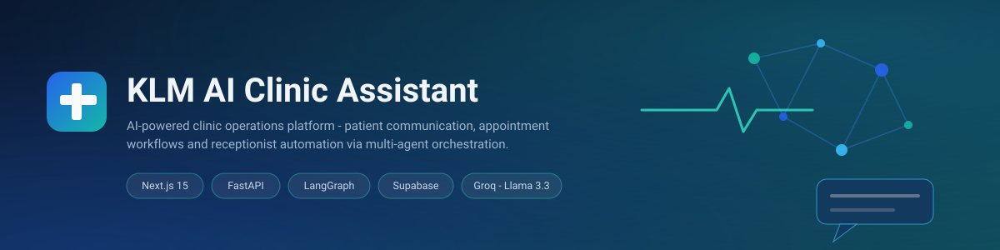

<div align="center">



# 🏥 KLM AI Clinic Assistant

**An AI-powered clinic operations platform that automates patient communication, appointment workflows, and receptionist operations through intelligent multi-agent orchestration.**

[](LICENSE)
[](https://nextjs.org/)
[](https://react.dev/)
[](https://www.typescriptlang.org/)
[](https://tailwindcss.com/)
[](https://fastapi.tiangolo.com/)
[](https://www.python.org/)
[](https://langchain-ai.github.io/langgraph/)
[](https://groq.com/)
[](https://supabase.com/)
[](#-testing--quality)

**[🌐 Live Frontend](https://clinic-ai-assistant-one.vercel.app/)** ·
**[⚙️ Backend API](https://clinic-ai-backend-t38f.onrender.com/)** ·
**[📚 API Docs](https://clinic-ai-backend-t38f.onrender.com/docs)** ·
**[🎮 Demo Login](#-public-demo-login)**

</div>

---

## 📑 Table of Contents

<details open>
<summary>📋 Click to expand table of contents</summary>

- [📌 Project Status](#-project-status)
- [🎮 Public Demo Login](#-public-demo-login)
- [❗ Problem Statement](#-problem-statement)
- [✨ Key Features](#%EF%B8%8F-key-features)
- [🛠️ Technology Stack](#%EF%B8%8F-technology-stack)
- [🏗️ System Architecture](#%EF%B8%8F-system-architecture)
- [🤖 AI Workflow (LangGraph)](#-ai-workflow)
- [📚 API Documentation](#-api-documentation)
- [🔐 Authentication & Security](#-authentication--security)
- [🗄️ Database Deep Dive](#%EF%B8%8F-database-deep-dive)
- [📦 Code Walkthrough](#-code-walkthrough)
- [🚀 Deployment Guide](#-deployment-guide)
- [📜 Testing & Quality](#-testing--quality)
- [📂 Repository Structure](#-repository-structure)
- [🗺️ Roadmap & Future Scope](#%EF%B8%8F-roadmap--future-scope)
- [👨‍💻 Author & Interview Tips](#-author--interview-tips)

</details>

---

## 📌 Project Status

| Layer | Status | Details |
|---|---|---|
| **Frontend (Vercel)** | 🟢 **Deployed & live** | <https://clinic-ai-assistant-one.vercel.app/> — all 21 routes generated, clean build |
| **Backend (Render)** | 🟡 **Deployed — pending config** | <https://clinic-ai-backend-t38f.onrender.com/> — currently HTTP 503; awaiting Supabase `SUPABASE_SERVICE_ROLE_KEY` |
| **Supabase Database** | 🟡 Schema + 7 migrations committed | Production state not verifiable from this machine; migrations 001–007 committed to repo |
| **Public Demo Login** | 🟢 **Implemented & locally verified** | 20 backend tests + 9 frontend Vitest tests pass; demo fully functional when backend is configured |
| **Local Test Suites** | 🟢 **29 tests passing** | `pytest tests/test_demo_auth.py` → 20 passed; `npm test` → 9 passed; `tsc --noEmit` → clean; `npm run lint` → clean; `npm run build` → all routes generated |
| **Integrations** | 🟠 **Implemented in code** | WhatsApp (Twilio), Gmail (IMAP + API), APScheduler — require owner credentials to activate |

> ⚠️ **Transparency note:** All diagrams in this README are original illustrations created for this project — they are not screenshots of the running application. The live demo URL works when the backend Supabase configuration is complete.

---

## 🎮 Public Demo Login

### 🌐 Demo URL
<https://clinic-ai-assistant-one.vercel.app/login>

### 🔑 Demo Credentials

| Field | Value |
|---|---|
| **Email** | `demo@gmail.com` |
| **Password** | `demo123` |

### How the Demo Works

> **Important:** The demo uses the **real backend login API** — there is no fake frontend-only session.

- **Real authentication.** The demo signs in through `POST /api/v1/auth/login`, which calls **Supabase Auth (GoTrue)** and returns a genuine access token. The demo account is a real Supabase Auth user with the `receptionist` role.
- **Fictional sample data only.** Demo read endpoints never query production tables — they return deterministic, fictional sample data served by `backend/app/demo/data.py` (conversations, appointments, escalations, analytics, doctors, notifications).
- **Server-side write protection.** Demo write operations (takeover, resume AI, appointment changes, staff messages, profile edits, …) are rejected with **HTTP 403** by the backend guard `get_staff_user_for_write` / `reject_demo` — **not** merely hidden in the UI.
- **Idempotent provisioning.** On startup the backend signs in with the demo credentials first and only repairs the password if sign-in fails — it does **not** reset the password on every restart.
- **Isolation from real patients.** The demo account has its own `users` row with `is_demo = TRUE` and shares no rows with real patient or staff data. It is intentionally public and must never contain real patient information.
- **Demo credentials are public** — anyone can view and use them. They are **not** secret.

Disable the demo in production with `DEMO_MODE_ENABLED=false`.

### Demo Login Flow (Step-by-Step)

1. User clicks **Login as Demo User** on the login page
2. Frontend sets `email = demo@gmail.com`, `password = demo123` and submits the form
3. Form submits to `POST /api/v1/auth/login` (real backend call)
4. Backend checks `demo_enabled()` → calls `ensure_demo_user_session()`
5. `ensure_demo_user_session()` is **idempotent**:
   - If the account exists and password matches → no password change
   - If the account is missing → creates it once with the configured password
   - If the account exists but password no longer matches → repairs the password
6. Backend signs in via `db.auth.sign_in_with_password()` → returns real Supabase session
7. Frontend receives `access_token` and stores it in `localStorage`
8. `AuthContext` decodes the token, sets `user.is_demo = true`, and routes to `/dashboard`
9. Dashboard loads **fictional sample data** from `demo_data.py` — no real patient records are fetched
10. Any write attempt (takeover, appointment change, etc.) triggers `get_staff_user_for_write` → **HTTP 403** with message "The public demo account is read-only. This action was blocked."

---

## ❗ Problem Statement

Small clinics run their front desk on manual effort — and patients feel it:

| Problem | Impact |
|---|---|
| 📱 **Manual patient communication** | Staff answer the same hours/location/insurance questions all day across WhatsApp, email, and phone |
| 📅 **Appointment scheduling overhead** | Every booking, reschedule, and cancellation consumes receptionist time and is error-prone |
| ⏱️ **Delayed responses to inquiries** | Patients wait hours (or until the next morning) for simple answers |
| 🔀 **Fragmented channels** | WhatsApp, email, and web chats live in separate inboxes with no shared context |
| 🚨 **Missed emergency messages** | Urgent symptoms can sit unread in a busy inbox — a genuine patient-safety risk |
| 👩‍💼 **Receptionist overload** | The front desk juggles triage, scheduling, and follow-ups with no prioritization |
| 👁️ **No centralized visibility** | Managers cannot see AI performance, channel mix, or conversation history in one place |

**How this project addresses them:** every inbound message — web chat, WhatsApp webhook, or polled email — flows through a **LangGraph multi-agent workflow** that classifies intent, answers routine questions via **Groq (Llama 3.3 70B)**, books appointments against real doctor availability, and **automatically escalates emergencies and low-confidence cases to human staff** on a real-time receptionist dashboard with one-click takeover.

### Real-World Example: WhatsApp Appointment Request

1. Patient sends WhatsMsg: "Hi, I need a follow-up appointment with Dr. Maya Demo this week"
2. Twilio webhook receives the message → `POST /api/v1/webhooks/twilio`
3. FastAPI backend authenticates the caller, creates/retrieves patient + conversation, persists the message
4. `process_message()` runs the message through **LangGraph workflow**
5. `classify_intent()` → `IntentType.BOOK_APPOINTMENT` with confidence 0.94
6. `run_agent()` → `run_appointment_agent()` checks real doctor availability via Supabase
7. Response generated: "I have Thursday 10:30 AM or Friday 2:00 PM available. Which do you prefer?"
8. AI response returned to patient via WhatsApp
9. Conversation state updated in Supabase; dashboard receives realtime update via Supabase Realtime
11. Receptionist sees conversation in dashboard with AI confidence tracking

---

## ✨ Key Features

### 👤 Patient Experience

| Feature | How It Works |
|---|---|
| **Omnichannel intake** | Web chat, WhatsApp (Twilio webhook → `POST /api/v1/webhooks/twilio`), and email (Gmail IMAP polled every 15 s by APScheduler + Gmail API outbound replies) |
| **Appointment booking** | Checks real doctor schedules, leaves, holidays, and blocked slots before offering a slot; uses `availability()` from `demo_data.py` in demo mode |
| **Medical FAQ agent** | Answers clinic hours, address, and services questions from configured clinic info (via FAQ agent on Groq Llama 3.3 70B) |
| **Symptom triage** | Intent-routed triage agent with emergency detection (`detect_emergency()` in `intent_classifier.py`) |
| **Patient portal** | Dedicated Next.js portal: appointments, messages, notifications, medication reminders, profile |
| **Notification center** | Per-user notifications with unread counts and mark-as-read (via `notifications` API) |

### 👩‍💼 Receptionist Dashboard

| Feature | How It Works |
|---|---|
| **Live conversation feed** | All patient conversations ordered by latest activity, with message history and timelines (via `useConversations` TanStack Query hook) |
| **AI confidence tracking** | Every AI response carries an intent label and confidence score (via `node_classify_intent` in workflow) |
| **Human takeover** | One-click `takeover` / `resume-ai` switch with staff messaging and full timeline logging (via `takeover()` / `resume_ai()` in `demo_data.py`) |
| **Escalation queue** | Emergency, safety-violation, and low-confidence cases raised as dashboard alerts (via `escalations()` and `_ESCALATION_ROWS`) |
| **Appointment management** | Status updates, doctor availability views (via `appointments()` and `availability()` in `demo_data.py`) |
| **Analytics** | Dashboard stats, intent distribution, channel mix, message volume, doctor utilization (via `analytics_summary()`, `dashboard_stats()`) |
| **Audit trail** | Activity log records system and user actions (via `_log_activity()` in `auth_service.py`) |

### 🧠 AI Intelligence

| Component | Implementation |
|---|---|
| **LangGraph orchestration** | Compiled `StateGraph` singleton in `backend/app/graph/workflow.py` with nodes: `classify_intent → run_agent → validate_safety → (escalate | end)` |
| **Intent classification** | LLM-based classification into `IntentType` (book/reschedule/cancel appointment, FAQ, symptom, reminder, follow-up, human support) with confidence score |
| **Specialized agents** | Appointment, FAQ, triage, reminder, escalation agents on Groq `llama-3.3-70b-versatile` |
| **Safety validation layer** | Checks generated responses before delivery; unsafe responses replaced with safe fallback (`get_safe_fallback_response()`) |
| **Emergency escalation logic** | Keyword scan (`detect_emergency()`) bypasses LLM + `SYMPTOM_QUERY` intent; emergency keywords: "chest pain", "can't breathe", "bleeding", "unconscious", etc. |
| **Human-in-the-loop** | Receptionists can take over any conversation mid-stream and hand it back via `resume_ai()` |

### 🎮 Demo Mode

- Public one-click demo login through real Supabase Auth
- Deterministic fictional sample data across every dashboard view
- Server-enforced read-only access (HTTP 403 on writes)
- Idempotent provisioning, no external side effects, isolated from real data

---

## 🛠️ Technology Stack

<div align="center">

**Frontend**


**Backend**


**AI**


**Database**


**Integrations & Deployment**


</div>

### Version Details (verified from `requirements.txt` / `package.json`)

| Layer | Technology | Version | Confirmed Source |
|---|---|---|---|
| Frontend | Next.js (App Router) | `^15.5.19` | `frontend/package.json` |
| Frontend | React + TypeScript | `^19.2.7` / `5.8.2` | `frontend/package.json`, `frontend/tsconfig.json` |
| Frontend | Tailwind CSS | `^4` | `frontend/package.json` |
| Frontend | TanStack Query | `^5.101.2` | `frontend/package.json` |
| Frontend | Zustand | `^5.0.14` | `frontend/package.json` |
| Frontend | Recharts / Framer Motion / Sonner | `^3.9` / `^12.42` / `^2.0` | `frontend/package.json` |
| Backend | FastAPI + Uvicorn | `0.115.5` / `0.32.1` | `backend/requirements.txt` |
| Backend | Pydantic / pydantic-settings | `2.14.3` / `2.7.0` | `backend/requirements.txt` |
| AI | LangGraph / LangChain Core / langchain-groq | `0.2.60` / `0.3.29` / `0.2.3` | `backend/requirements.txt` |
| Database | supabase-py | `>=2.34.1` | `backend/requirements.txt` |
| Integrations | Twilio / IMAPClient / google-api-python-client / APScheduler | `9.4.4` / `3.0.1` / `2.112.0` / `3.10.4` | `backend/requirements.txt` |

> **⚠️ Important:** The UI is built with **Tailwind CSS + hand-rolled components**. **Shadcn UI is NOT used** — this common inaccuracy was in earlier README versions and has been corrected. Icons use `lucide-react` / `react-icons`.

### Technology Alternatives Considered (and why we chose what we have)

| Technology | Alternative | Why We Chose This |
|---|---|---|
| **Next.js** | Gatsby, Create React App | App Router + middleware + API routes in one project + ISR + Revalidation |
| **FastAPI** | Flask, Django REST Framework | Automatic `/docs` + type validation via Pydantic + async support + performance |
| **LangGraph** | Simple LLM chain, LangChain sequential | Cyclic graph + conditional routing + human-in-the-loop + state persistence |
| **Groq** | OpenAI API, Anthropic | Lower latency + cost-effective for Llama 3.3 70B + streaming support |
| **Supabase** | MongoDB, Firebase, raw PostgreSQL | Real-time built-in + Auth + RLS + PostgreSQL + generous free tier |
| **PostgreSQL** | MongoDB, DynamoDB | Relational data + structured queries + migrations + ACID transactions |
| **React Query** | SWR, Relay | Automatic caching + refetching + pagination + optimistic updates + TanStack ecosystem |
| **Zustand** | Redux, Jotai, Recoil | Zero-boilerplate state + TypeScript typings + persist client + small bundle |

---

## 🏗️ System Architecture


### How Data Flows Through the System

```
1. INBOUND CHANNELS
   │
   ├── 🌐 Web Chat     ──→ Patient types in portal → Next.js frontend
   ├── 💬 WhatsApp     ──→ Twilio webhook → POST /api/v1/webhooks/twilio
   └── 📧 Email        ──→ Gmail IMAP poll (APScheduler, every 15 s)
   │
   ▼
2. FASTAPI BACKEND (Render)
   │
   ├── 🔐 Auth middleware → Supabase JWT validation
   ├── 🌐 API routes → /api/v1/* (16 router groups)
   ├── 🧠 LangGraph workflow → classify → route → validate → escalate/end
   ├── 🤖 Groq LLM → llama-3.3-70b-versatile via LangChain
   ├── 💾 Supabase PG → PostgreSQL (with RLS)
   └── 🔔 WebSocket / Realtime → push updates to dashboard
   │
   ▼
3. SUPABASE POSTGRESQL
   │
   ├── 👥 users (is_demo flag, RLS policies)
   ├── 💬 conversations + messages
   ├── 📅 appointments + doctors
   ├── ⚠️ escalations + notifications
   └── 📊 analytics_cache + activity_log
   │
   ▼
4. RECEPTIONIST DASHBOARD (Vercel)
   │
   ├── 📊 TanStack Query → refetch on realtime channel events
   ├── 🔔 WebSocket channel (/ws) → live conversation updates
   ├── 📊 Recharts → analytics charts
   └── 🛡️ Role-based UI → demo read-only guards
```

### Component Details

| Component | Responsibility | Tech |
|---|---|---|
| **Next.js Frontend** | UI, auth context, API calls, WS handling, dashboard | Next.js 15, React 19, Tailwind |
| **FastAPI Backend** | REST API, WebSocket, business logic, AI orchestration | Python 3.11, FastAPI, Pydantic |
| **LangGraph Workflow** | Intent → agent routing → safety → escalation | StateGraph, compiled singleton |
| **Groq LLM** | Text generation for intent, agents, safety validation | Llama 3.3 70B via `langchain_groq` |
| **Supabase** | Auth, PostgreSQL, Realtime, RLS | `supabase-py >= 2.34.1` |
| **Twilio** | WhatsApp inbound webhook + message sending | `twilio==9.4.4` |
| **APScheduler** | Email IMAP polling every 15 s + background jobs | `apscheduler==3.10.4` |
| **Vercel** | Frontend hosting + edge functions + env vars | Production builds + `NEXT_PUBLIC_*` inlined |
| **Render** | Backend service + Python runtime + env vars | `python-3.11.9` from `runtime.txt` |

### Data Flow: Patient Message → Dashboard Update

```
Patient message
    ↓
Twilio webhook / IMAP poll / Web chat POST /chat
    ↓
FastAPI: patient_repo.upsert() + conversation_repo.upsert()
    ↓
process_message() → LangGraph workflow
    ↓
node_classify_intent() → IntentType + confidence
    ↓
node_run_agent() → Specialist agent response
    ↓
node_validate_safety() → safe / escalate
    ↓
final_state → ChatResponse (message, intent, confidence, escalated)
    ↓
Persist AI response + conversation state to Supabase
    ↓
Supabase Realtime channel → "conversations_updated"
    ↓
TanStack Query auto-refetch → Dashboard updates
    ↓
Receptionist sees new conversation + AI confidence
```

---

## 🤖 AI Workflow (LangGraph)

### What is LangGraph?

**LangGraph** is a library for building cyclic, stateful graphs of LLM calls. Unlike LangChain's simple sequential chains, LangGraph allows:

- **State persistence** across multiple LLM calls
- **Conditional routing** based on state
- **Human-in-the-loop** interruptions
- **Edge traversal** (can go back/forth between nodes)
- **Graph persistence** (checkpointing, resume)

### Why LangGraph for This Project?

A simple LLM API call can't handle:

1. **Multi-step workflow** (classify → route → validate → respond)
2. **Emergency detection** that bypasses normal flow
3. **Human takeover** with state resumption
4. **Confidence-based escalation** (threshold 0.6)
5. **Safety validation** of AI-generated content

### The Graph Structure

```
graph TD
    A[classify_intent] --> B[run_agent]
    B --> C[validate_safety]
    C -->|is_safe| D[END]
    C -->|unsafe/low-conf| E[escalate]
    E --> F[escalate_agent]
    F --> D
```

### Workflow State

The graph state (`dict`) carries throughout the entire flow:

```python
state = {
    "message": str,           # Original patient message
    "patient_id": str,        # UUID or DB patient ID
    "conversation_id": str,   # UUID or DB conversation ID
    "channel": str,           # "web", "whatsapp", "email"
    "intent": IntentType,     # classified intent
    "confidence": float,      # LLM confidence (0.0 - 1.0)
    "response": str | None,   # Generated AI response
    "escalated": bool,        # True if escalated human/emergency
    "escalation_reason": str | None,  # e.g. "low_confidence_0.45"
    "metadata": {"patient_name": str},
    "error": str | None,      # any error during processing
}
```

### Step-by-Step: Normal Message Flow

| Step | Node | What Happens |
|---|---|---|
| 1 | `classify_intent` | LLM classifies message; emergency phrases bypass LLM via `detect_emergency()` |
| 2 | `run_agent` | Conditional routing: BOOK_APPOINTMENT → appointment_agent, FAQ → faq_agent, SYMPTOM_QUERY → triage_agent, etc. |
| 3 | `validate_safety` | - If `confidence < 0.6` → escalate with low-confidence reply<br>- LLM safety validator checks for forbidden patterns + unsafe medical advice<br>- If unsafe → safe fallback response |
| 4 | `should_escalate()` | If `state["escalated"]` → "escalate"; else → "end" |
| 5 | `END` | Return AI response to patient; update conversation state in Supabase |

### Step-by-Step: Emergency Message Flow

**Message:** "I have severe chest pain and difficulty breathing."

| Step | Node | Outcome |
|---|---|---|
| 1 | `detect_emergency()` | **Fast path:** "chest pain" + "difficulty breathing" match emergency phrases → returns `True` |
| 2 | Skips LLM classification | Directly returns `IntentType.SYMPTOM_QUERY, confidence=0.99` |
| 3 | `run_agent()` → `run_triage_agent()` | Triage agent recognizes emergency → generates escalation response |
| 4 | `validate_safety()` | Confidence 0.99 > 0.6, but emergency flag already set → bypasses safety check |
| 5 | `should_escalate()` | `escalated=True` → returns "escalate" |
| 6 | `node_escalate()` | Calls `run_escalation_agent()` → writes escalation summary |
| 7 | Dashboard alert | Receptionist sees **CRITICAL escalation** with reason "Chest tightness after exercise — possible cardiac symptom" |
| 8 | Human takeover | Receptionist clicks "Take Over" → `takeover()` sets `ownership: HUMAN_ACTIVE` |
| 9 | AI retreats | `resume_ai()` returns ownership to `AI_ACTIVE` when appropriate |

### Emergency Detection Key Phrases (from `intent_classifier.py`)

```
"chest pain", "difficulty breathing", "can't breathe", "cant breathe",
"severe bleeding", "unconscious", "unconsciousness", "allergic reaction",
"anaphylaxis", "stroke", "heart attack", "overdose", "poisoning",
"not breathing", "passing out", "collapsed"
```

> ⚠️ **Important:** This is **software escalation**, not medical diagnosis. The system connects patients with human staff — it does not diagnose or prescribe medication.

### What Happens When AI Cannot Classify an Intent?

If `classify_intent()` throws an exception or returns confidence 0.3:

1. Defaults to `IntentType.FAQ, confidence=0.3`
2. `validate_safety()` sees `confidence < 0.6` → escalates
3. Response: "I apologize for the inconvenience. Please contact us directly at +1-212-555-0911 and our team will assist you."
4. Conversation marked as `HUMAN_SUPPORT` → immediately escalates to receptionist

---

## 📚 API Documentation

Full interactive reference at:
**<https://clinic-ai-backend-t38f.onrender.com/docs>** *(currently 503 until backend Supabase config is restored)*

All routers mounted under `/api/v1` prefix (`backend/app/api/`):

| Group | Prefix | Key Endpoints |
|---|---|---|
| **Authentication** | `/api/v1/auth` | `POST /register`, `POST /login`, `GET /demo-config`, `POST /refresh`, `POST /logout`, `POST /forgot-password`, `POST /reset-password`, `POST /change-password`, `GET /me` |
| **Chat** | `/api/v1/chat` | `POST /` — primary entry point; runs LangGraph workflow (simulated for demo tokens) |
| **Dashboard** | `/api/v1/dashboard` | `GET /stats`, `GET /analytics`, `GET /patients` |
| **Conversations** | `/api/v1/conversations` | `GET ""` (list), `GET /{id}`, `GET /{id}/timeline` |
| **Takeover** | `/api/v1/conversations` | `POST /{id}/takeover`, `POST /{id}/resume-ai`, `POST /{id}/staff-message`, `GET /{id}/ownership` |
| **Appointments** | `/api/v1/appointments` | `PATCH /{id}/status`, `GET /{id}` |
| **Doctors** | `/api/v1/doctors` | availability, slots, schedules, leaves, holidays |
| **Escalations** | `/api/v1/escalations` | `POST /escalate`, `PATCH /{id}/status` |
| **Notifications** | `/api/v1/notifications` | unread count, mark read, mark all read |
| **Analytics** | `/api/v1/analytics` | dashboard, intents, messages, performance, channels, doctors, CSV export |
| **Patient Portal** | `/api/v1/patient` | portal dashboard, profile, appointments CRUD, messages, notifications, medication reminders, search |
| **Medications** | `/api/v1/medications` | reminder detail, update, complete, delete |
| **Reminders** | `/api/v1/reminders` | `GET /pending` |
| **Admin** | `/api/v1/admin` | users list, system stats, profile get/update |
| **Webhooks** | `/api/v1/webhooks` | `POST /twilio` — WhatsApp inbound |
| **WebSocket** | `/api/v1/ws` | live conversation events |
| **Health** | `/health`, `/api/v1/health` | service health JSON |

### Demo Mode Behavior

- **Read endpoints** (list, get by ID, stats, etc.): return fictional sample data from `demo_data.py` when `is_demo_user(user)` is True
- **Write endpoints** (create, update, patch status, takeover, etc.): return **HTTP 403** with detail "The public demo account is read-only. This action was blocked."
- **Demo config** (`GET /api/v1/auth/demo-config`): returns `{"enabled": true, "email": "demo@gmail.com", "password": "demo123", "name": "Demo Receptionist", "role": "receptionist", "read_only": true}`

### Authentication Flow

```
User login
    ↓
POST /api/v1/auth/login {email, password}
    ↓
Backend: supabase.auth.sign_in_with_password()
    ↓
Supabase Auth (GoTrue) → access token + refresh token
    ↓
Frontend: store token in localStorage
    ↓
AuthContext.getCurrentUser() → validates token via Supabase
    ↓
user.role → determines UI access (receptionist / doctor / patient / admin)
    ↓
Protected routes: get_staff_user / get_staff_user_for_write
    ↓
HTTP 403 if demo user attempts write operation
```

---

## 🔐 Authentication & Security Deep Dive

### Authentication vs Authorization

| Concept | Definition | Implementation in This Project |
|---|---|---|
| **Authentication** | Verifying "who you are" | Supabase Auth (GoTrue) validates email/password → issues JWT access token |
| **Authorization** | Verifying "what you can do" | Role-based access control: `receptionist` / `doctor` / `admin` / `patient` |
| **JWT** | JSON Web Token | Signed by Supabase; contains `sub`, `email`, `role`, `user_metadata`; validated on every protected request |
| **Access token** | Short-lived credential (15-60 min) | Included in `Authorization: Bearer <token>` header on every API call |
| **Refresh token** | Long-lived credential (30 days) | Used to obtain new access token without re-login |
| **Session** | Server-side state (Supabase) | Managed by Supabase; can be revoked, expired, or invalidated |

### Complete Login Process

```
User enters credentials on login page
    │
    ▼
Frontend: authAPI.login(email, password)
    │
    ▼
POST /api/v1/auth/login to FastAPI backend
    │
    ▼
Backend: auth_service.login_user(email, password)
    │
    ├─► If demo_enabled() AND email == demo_email():
    │    │
    │    ▼
    │    ensure_demo_user_session()  ← idempotent provisioning
    │    │   - If account exists + password matches → no change
    │    │   - If account missing → create once with configured password
    │    │   - If password no longer matches → repair it
    │    │   - Returns (auth_user, session, profile)
    │    │
    │    ▼
    │    user = profile or _metadata_user(auth_user, is_demo=True)
    │    user["is_demo"] = True
    │    ▼
    │    Return access_token from Supabase session
    │
    └─► Else (normal user login):
         ▼
         supabase.auth.sign_in_with_password({email, password})
         ▼
         Return access_token + refresh_token
         ▼
user = _find_public_user() or _metadata_user(auth_user)
user["is_demo"] = is_demo_user(user)
    ▼
Return {success, user, access_token, refresh_token, expires_at}
    │
    ▼
Frontend: store token in localStorage via tokenManager.setToken()
    │
    ▼
AuthContext: setUser(response.user), syncUserCookie(user)
    │
    ▼
Router.push(dashboardRoute) based on role
```

### Role-Based Access Control (RBAC)

| Role | Can Access | Can Write |
|---|---|---|
| **receptionist** | Dashboard, conversations, appointments, notifications, analytics | ❌ No — demo 403; real users also restricted by `get_staff_user_for_write` |
| **doctor** | Same as receptionist + doctor-specific endpoints | ❌ No write on demo; real users have selective write access |
| **admin** | All endpoints + user management, system stats | ✅ Yes — service-role key required |
| **patient** | Patient portal: appointments, messages, profile, notifications | ✅ Portal CRUD only (PUT /appointments, POST/messages within limits) |

### Demo Write Protection

```python
# backend/app/auth/dependencies.py
async def get_staff_user_for_write(user: dict = Depends(get_staff_user)) -> dict:
    """Staff-only, and the public demo account is read-only."""
    if is_demo_user(user):
        raise HTTPException(
            status_code=status.HTTP_403_FORBIDDEN,
            detail="The public demo account is read-only. This action was blocked.",
        )
    return user
```

This guard is applied to **every** write API endpoint. Even if a demo user somehow obtains a valid token, the server rejects write operations with HTTP 403.

### JWT Validation Fallback

When Supabase Auth is briefly unreachable, the backend can still validate users using a local JWT fallback:

```python
# backend/app/auth/service.py
def _decode_supabase_jwt(self, access_token: str) -> Optional[dict]:
    """Local verification fallback for transient Supabase Auth outages."""
    secret = getattr(settings, "SUPABASE_JWT_SECRET", None)
    if not secret:
        return None
    try:
        payload = jwt.decode(
            access_token,
            secret,
            algorithms=["HS256"],
            options={"verify_aud": False},
        )
        # ... return user dict with is_demo flag
    except jwt.PyJWTError:
        return None
```

This keeps the app running during brief Supabase outages.

### Secret Key Management

| Key | Where Used | Exposure |
|---|---|---|
| `SUPABASE_URL` | Supabase client init (backend + frontend) | 🔒 Secret — never commit |
| `SUPABASE_ANON_KEY` | Frontend GoTrue HTTP (sign-in, settings) | 🌐 Public — safe to expose in frontend |
| `SUPABASE_SERVICE_ROLE_KEY` | Backend admin access (DB writes, Auth admin) | 🔒 Secret — Render env only; **critical key** |
| `SECRET_KEY` | FastAPI session signing | 🔒 Secret — `.env` only |
| `GROQ_API_KEY` | LLM access | 🔒 Secret — never expose |
| `DEMO_USER_PASSWORD` | Demo login (publicly advertised) | 🌐 Intentionally public |
| `SUPABASE_JWT_SECRET` | Local JWT verification fallback | 🔒 Secret — optional, local only |

### CORS Configuration

```python
# backend/app/main.py
ALLOWED_ORIGINS = [
    "http://localhost:3000", "http://127.0.0.1:3000",  # dev
    "http://localhost:3001", "http://127.0.0.1:3001",
    "http://localhost:3002", "http://127.0.0.1:3002",
    "http://localhost:3003", "http://127.0.0.1:3003",
    "https://clinic-ai-assistant-one.vercel.app",  # prod frontend
]
allow_origin_regex=r"https://.*\.vercel\.app",  # preview deployments
allow_credentials=True  # requires explicit origin list (no wildcard)
```

> 💡 **Why no wildcard?** `allow_credentials=True` requires explicit origin list per RFC 7231. Using `allow_origins=["*"]` with credentials would browsers reject.

### Demo Data Isolation

- **Database:** Demo account's `users` row has `is_demo = TRUE` (column added by migration 007). Partial index `idx_users_is_demo` filters only demo rows.
- **Reads:** All demo API endpoints check `is_demo_user(user)` first; if True, return `demo_data.*` static data — **never** query real patient/conversation/appointment tables.
- **Writes:** `get_staff_user_for_write()` returns HTTP 403 for demo users on every write endpoint.
- **State:** In-memory demo overrides (`_OWNERSHIP_OVERRIDES` in `demo_data.py`) only exist for the current process lifetime — they clear on backend restart.
- **No real patient data:** The demo is explicitly designed so a public visitor can never see genuine patient information (see `demo_data.py` docstring, lines 2-8).

---

## 🗄️ Database Deep Dive

### Supabase Project & Schema

| Item | Value |
|---|---|
| **Project URL** | `https://mxvxwqlhsypjehcdrgqp.supabase.co` *(new project; original `kxliehrgflqkhnejbykr` does not resolve DNS)* |
| **Database** | PostgreSQL via Supabase |
| **ORM/Client** | `supabase-py >= 2.34.1` |
| **Migrations** | 7 files: `schema.sql` + `migrations/001`–`007_demo_mode.sql` |
| **Row Level Security** | Enabled via policies in `schema.sql` |
| **Realtime Publication** | `supabase_realtime` with 7 dashboard tables |

### Database Tables (from `schema.sql`)

| Table | Key Columns | RLS Policy |
|---|---|---|
| **users** | `id`, `email`, `role`, `is_demo`, `auth_user_id` | `service_role` ALL; `anon` SELECT (is_active=true) |
| **conversations** | `id`, `patient_id`, `channel`, `intent`, `status`, `ownership`, `last_message_at` | `service_role` ALL; `anon` SELECT |
| **messages** | `id`, `conversation_id`, `sender`, `content`, `timestamp` | `service_role` ALL; `anon` SELECT |
| **escalations** | `id`, `patient_id`, `conversation_id`, `reason`, `priority`, `status`, `summary` | `service_role` ALL; `anon` SELECT |
| **notifications** | `id`, `type`, `title`, `body`, `is_read`, `created_at` | `service_role` ALL; `anon` SELECT some |
| **appointments** | `id`, `patient_id`, `doctor_id`, `date`, `slot_start`, `slot_end`, `status` | `service_role` ALL; `anon` SELECT |
| **doctors** | `id`, `name`, `specialty`, `is_active`, `emergency_only` | `service_role` ALL; `anon` SELECT is_active=true |
| **staff** | `id`, `user_id`, `position`, `department`, `is_active` | `service_role` ALL |
| **patient** | `id`, `user_id`, `name`, `phone`, `email`, `preferred_channel` | `service_role` ALL |
| **activity_log** | `id`, `user_id`, `action`, `resource`, `resource_id`, `details` | `service_role` ALL |
| **analytics_cache** | Pre-computed metrics for dashboard | `service_role` ALL |

### Primary & Foreign Keys

| Parent Table | Child Table | Foreign Key |
|---|---|---|
| **users** | **patient** | `patient.user_id = users.id` (one-to-many: one user has one patient profile) |
| **users** | **staff** | `staff.user_id = users.id` (one-to-many) |
| **conversations** | **messages** | `messages.conversation_id = conversations.id` (one-to-many) |
| **conversations** | **escalations** | `escalations.conversation_id = conversations.id` (one-to-many) |
| **appointments** | **patient** (via conversations) | `appointments.patient_id` references patient or conversation patient |
| **doctors** | **doctor_schedules** | `doctor_schedules.doctor_id = doctors.id` |

### Indexes (from `schema.sql`)

| Table | Index | Purpose |
|---|---|---|
| **users** | `idx_users_email` | Fast email lookup (registration + login) |
| **users** | `idx_users_auth_user_id` | Map Supabase auth_user_id → local user row |
| **users** | `idx_users_role` | Filter by role (RLS + API queries) |
| **patients** | `idx_patients_user_id` | Find patient by user ID |
| **doctors** | `idx_doctors_name` | Search doctors by name |
| **doctors** | `idx_doctors_active` | Filter active doctors |
| **doctors** | `idx_doctors_emergency` | Filter emergency-only doctors |
| **appointments** | `idx_appointments_doctor` | Find appointments by doctor |
| **appointments** | `idx_appointments_slot_start` | Slot-based appointment queries |
| **appointments** | `idx_appointments_conversation` | Link appointments to conversations |
| **conversations** | `idx_conversations_ownership` | Filter by ownership (AI / human) |
| **notifications** | `idx_notifications_read` | Unread count queries |
| **notifications** | `idx_notifications_type` | Filter by notification type |
| **notifications** | `idx_notifications_time` | Timeline ordering |
| **blocked_slots** | `idx_blocked_slots_doctor` | Doctor availability exclusion |
| **blocked_slots** | `idx_blocked_slots_time` | Time-slot conflict detection |

### Migration Sequence (001–007)

| Order | File | What It Does |
|---|---|---|
| 0 | `schema.sql` | Initial schema — all core tables, doctors, schedules, leaves, holidays, blocked slots, RLS policies |
| 1 | `migrations/001_processed_emails.sql` | `processed_emails` table — dedupe inbound emails by Message-ID |
| 2 | `migrations/002_patient_portal.sql` | Additive patient-portal completion tables/columns |
| 3 | `migrations/003_patient_dashboard_production.sql` | Doctors-table updates + `medication_reminders` table |
| 4 | `migrations/004_ai_logs_activity_production.sql` | AI log + activity log hardening |
| 5 | `migrations/005_medication_reminders_production.sql` | Final medication-reminders schema |
| 6 | `migrations/006_conversation_last_message.sql` | `conversations.last_message` + `last_message_at` for fast list views |
| 7 | `migrations/007_demo_mode.sql` | **`users.is_demo`** column + partial index + adds 7 dashboard tables to `supabase_realtime` publication (idempotent) |

> ⚠️ **Apply in order.** Migration 007 is idempotent (safe to re-run). No production rows are seeded by any migration.

### Supabase Auth

- **Provider:** GoTrue (embedded in Supabase)
- **Login:** `sign_in_with_password({email, password})`
- **Registration:** `auth.admin.create_user({email, password, user_metadata})`
- **Tokens:** JWT access tokens (short-lived) + refresh tokens (30 days)
- **Demo provisioning:** `ensure_demo_user_session()` — idempotent; creates account if missing; repairs password if it changed
- **Public demo config:** `GET /api/v1/auth/demo-config` returns `enabled, email, password, name, role, read_only` — credentials are intentionally public

### Row Level Security Policies (selected from `schema.sql`)

```sql
-- Anon can read these tables
CREATE POLICY "anon_read_conversations" ON conversations FOR SELECT TO anon USING (true);
CREATE POLICY "anon_read_messages" ON messages FOR SELECT TO anon USING (true);
CREATE POLICY "anon_read_escalations" ON escalations FOR SELECT TO anon USING (true);
CREATE POLICY "anon_read_doctors" ON doctors FOR SELECT TO anon USING (is_active = true);
CREATE POLICY "anon_read_appointments" ON appointments FOR SELECT TO anon USING (true);

-- Service role can do everything
CREATE POLICY "service_role_users" ON users FOR ALL TO service_role USING (true) WITH CHECK (true);
CREATE POLICY "service_role_conversations" ON conversations FOR ALL TO service_role USING (true) WITH CHECK (true);
-- ... similar for all tables
```

### Demo User Identification

The demo user is identified by **two mechanisms**:

1. **`users.is_demo` column** (migration 007): `BOOLEAN NOT NULL DEFAULT FALSE` — only the demo account has `TRUE`
2. **`is_demo()` function** ( `backend/app/demo/service.py` ): Checks `user.get("is_demo") is True` **OR** `user.email == demo_email()` (i.e., `demo@gmail.com`)

Both checks are used interchangeably throughout the codebase. The `is_demo` flag on the `users` table is the authoritative source; the email check is a backward-compatible fallback for deployments that haven't applied the migration yet.

### Sample SQL Queries from the Project

```sql
-- Find demo user (from conftest.py / test_demo_auth.py)
SELECT email, role, is_demo FROM public.users WHERE is_demo = TRUE;

-- Check if user is demo (from auth dependencies)
-- Application code: user.get("is_demo") is True OR user.email == "demo@gmail.com"

-- Realtime publication check
SELECT * FROM pg_publication_tables WHERE pubname = 'supabase_realtime';

-- Add demo user to realtime (migration 007 adds these tables automatically)
ALTER TABLE public.conversations REPLICA IDENTITY FULL;
ALTER PUBLICATION supabase_realtime ADD TABLE public.conversations;
-- ... repeat for 6 more tables
```

### Complete Login Flow ( Illustrated )

```
+---------------------+      +----------------------+      +----------------------+
|  Login Page (React) | ---> |  FastAPI (/auth/login)| ---> |  Supabase Auth (GoTrue)|
|  email: demo@...    |      |  {email, password}   |      |  access_token + session|
|  password: demo123  |      |                      |      |----------------------->|
+---------------------+      +----------------------+      +----------------------+
           │                              │                            │
           │                              │                            │
           │  access_token                │  user profile              │
           │<-----------------------------+                            │
           │                              │                            │
           │  is_demo = true              │  role = receptionist       │
           │                              │                            │
           ▼                              ▼                            ▼
  Store in localStorage        Set AuthContext user        Dashboard loads
  tokenManager.setToken()      is_demo=true                fictional sample data
```

---

## 📦 Code Walkthrough

### Backend Files (Priority Order)

| File | Responsibility | Key Functions/Classes |
|---|---|---|
| **`backend/app/main.py`** | FastAPI app entry point | `lifespan()` (startup/shutdown), CORS config, health endpoints, router inclusion |
| **`backend/app/config/settings.py`** | Pydantic settings management | All env vars + `parse_bool()` validator + `lru_cache` `get_settings()` |
| **`backend/app/auth/service.py`** | Complete Auth logic | `login_user()`, `register_user()`, `refresh_token()`, `logout()`, `forgot_password()`, `reset_password()`, `change_password()`, `_decode_supabase_jwt()`, `get_user_by_token()`, `_log_activity()` |
| **`backend/app/auth/dependencies.py`** | FastAPI Depends() for auth | `bearer_token()`, `get_current_user()`, `get_optional_user()`, `get_staff_user()`, `get_staff_user_for_write()`, `reject_demo()` |
| **`backend/app/demo/service.py`** | Idempotent demo provisioning | `demo_enabled()`, `demo_email()`, `demo_password()`, `is_demo_user()`, `ensure_demo_user_session()`, `ensure_demo_user_sync()`, `demo_public_config()` |
| **`backend/app/demo/data.py`** | Isolated sample data | `patients()`, `doctors()`, `conversations()`, `messages()`, `timeline()`, `takeover()`, `resume_ai()`, `add_staff_message()`, `appointments()`, `escalations()`, `notifications()`, `dashboard_stats()`, `admin_users()`, `system_stats()` |
| **`backend/app/graph/workflow.py`** | LangGraph orchestration | `build_graph()`, `process_message()`, `node_classify_intent()`, `node_run_agent()`, `node_validate_safety()`, `node_escalate()`, `should_escalate()` |
| **`backend/app/api/auth.py`** | Auth API routes | `register()`, `demo_config()`, `login()`, `refresh()`, `forgot_password()`, `reset_password()`, `change_password()` |
| **`backend/app/api/dashboard.py`** | Dashboard API routes | `dashboard_stats()` (demo data or DB), `analytics()`, `list_patients()` |
| **`backend/app/api/conversations.py`** | Conversation API routes | `list_conversations()`, `get_conversation()`, `get_conversation_timeline()` |
| **`backend/app/api/chat.py`** | Chat entry point | `chat()` → `_demo_reply()` for demo, or `handle_chat()` for real patients |
| **`backend/app/agents/intent_classifier.py`** | Intent classification | `detect_emergency()`, `classify_intent()` → LLM + confidence + IntentType |
| **`backend/app/agents/appointment_agent.py`** | Appointment handling | `_extract_requested_datetime()`, `_extract_time()`, `run_appointment_agent()` |
| **`backend/app/repositories/`** | Data access layer | `patient_repo`, `conversation_repo`, `message_repo`, `escalation_repo`, `ai_log_repo`, `activity_log_repo` |
| **`backend/app/db/supabase_client.py`** | Supabase client per operation | `get_supabase()` → `create_client(URL, SERVICE_ROLE_KEY)`; fresh per call |
| **`backend/app/utils/llm_client.py`** | Groq LLM wrapper | `call_llm()`, `call_llm_json()` → `ChatGroq(model_name="llama-3.3-70b-versatile")` |
| **`backend/app/main.py` lifespan** | Startup/shutdown | Starts APScheduler email poller; idempotent demo user provisioning |

### Frontend Files (Priority Order)

| File | Responsibility | Key Functions/Classes |
|---|---|---|
| **`frontend/app/login/page.tsx`** | Login page UI | Demo credentials display, `handleDemoLogin()`, `handleSubmit()`, `AuthAPI` calls |
| **`frontend/contexts/AuthContext.tsx`** | Auth state + role | `AuthProvider`, `useAuth()`, `login()`, `logout()`, `register()`, `isDemo`, `hasRole()`, cookie sync |
| **`frontend/lib/api.ts`** | TanStack Query hooks | `useConversations()`, `useConversation(id)`, `useAppointments()`, `useDashboard()`, `useAnalytics()`, `useNotifications()` |
| **`frontend/lib/auth.ts`** | Auth API client | `authAPI.login()`, `authAPI.register()`, `authAPI.getDemoConfig()`, `authAPI.logout()`, `authAPI.refreshToken()`, `authAPI.getCurrentUser()`, `tokenManager`, `User` interface, `hasRole*()`, `getDashboardRoute()` |
| **`frontend/lib/apiBase.ts`** | URL resolution | `resolveApiBase()` → `NEXT_PUBLIC_API_URL` or production fallback; `getWebSocketUrl()` |
| **`frontend/hooks/useDashboard.ts`** | Dashboard data | Fetches conversations, stats, patients via `api.ts`; handles demo vs real data |
| **`frontend/hooks/useRealtime.ts`** | WebSocket + Realtime | Supabase channel subscription, event handlers, graceful fallback on disconnect |
| **`frontend/hooks/useWebSocket.ts`** | Low-level WS | `connect()`, `disconnect()`, `send()`, `receive()`, reconnect with backoff |
| **`frontend/components/layout/Sidebar.tsx`** | Navigation | Role-based menu items (receptionist vs patient vs shared) |
| **`frontend/components/layout/TopNav.tsx`** | Top navigation | User profile, demo status log-out, help links |
| **`frontend/components/landing/Features.tsx`** | Landing page | Feature highlights grid for the landing site |
| **`frontend/components/landing/Workflow.tsx`** | Landing page | Visual workflow illustration for the landing site |
| **`frontend/middleware.ts`** | Next.js middleware | Role-based route protection; redirects patients from `/dashboard`, receptionists from `/patient` |
| **`frontend/providers/QueryClientProvider.tsx`** | TanStack Query | `QueryClient` with persistence + hydration across page reloads |

### Key Code Flow: Message Received → Dashboard Updated

```
1. Twilio webhook → POST /api/v1/webhooks/twilio
    │
    └─► backend/app/api/webhooks.py → process Twilio payload
        │
        └─► chat_service.handle_chat(request)
            │
            ├─► patient_repo.upsert(patient data)
            │
            ├─► conversation_repo.upsert(conversation data)
            │
            ├─► message_repo.create(message data) — persists patient's message
            │
            ├─► process_message(message, patient_id, conversation_id, channel)
            │    │
            │    └─► LangGraph workflow (compiled singleton)
            │       │
            │    ├─ node_classify_intent() → IntentType + confidence
            │    │
            │    ├─ node_run_agent() → Specialist agent → Groq LLM response
            │    │
            │    ├─ node_validate_safety() → safe / escalate
            │    │
            │    └─ final_state → ChatResponse
            │
            └─► Persist AI response + conversation state to Supabase
                 │
                 ├─► conversations table: update last_message, last_message_at, updated_at
                 │
                 ├─► messages table: INSERT new message
                 │
                 └─► Supabase Realtime: broadcast "conversations_updated" event
                      │
                      └─► Frontend: TanStack Query auto-refetch → Dashboard updates
```

### Demo Data Flow (No Database Writes)

```
1. Demo chat message → POST /api/v1/chat
    │
    └─► chat_service.handle_chat(request)
        │
        ├─► is_demo_user(user) → True
        │
        ├─► _demo_reply(message) → deterministic response from demo_data.py
        │
        └─► Return ChatResponse with:
            - fictional conversation_id from _CONVERSATIONS[0]
            - fictional patient_id from _PATIENT_ROWS[0]
            - metadata: {"demo": True, "simulated": True, "no_external_actions": True}
            - NO database writes (no patient/create, no conversation persist, no email/WhatsApp)
```

---

## 🚀 Deployment Guide

### Production URLs (documented for this project)

| Service | URL | Status |
|---|---|---|
| **Frontend (Vercel)** | <https://clinic-ai-assistant-one.vercel.app/> | 🟢 Live |
| **Backend API (Render)** | <https://clinic-ai-backend-t38f.onrender.com/> | 🟡 HTTP 503 — pending Supabase config |
| **API Docs (Swagger)** | <https://clinic-ai-backend-t38f.onrender.com/docs> | 🟡 503 |
| **Health Check** | <https://clinic-ai-backend-t38f.onrender.com/health> | 🟡 503 |
| **Demo Config** | <https://clinic-ai-backend-t38f.onrender.com/api/v1/auth/demo-config> | 🟡 503 |

> The backend returns HTTP 503 because the Supabase `SUPABASE_SERVICE_ROLE_KEY` has not been configured from the new Supabase project's dashboard. See the [Deployment Guide](#-deployment-guide) for fixing this.

### A. Supabase

1. **Create or restore a project:**
   - If restoring original: recreate project host `kxliehrgflqkhnejbykr` and DNS
   - If creating new: use the new project `mxvxwqlhsypjehcdrgqp` (live with valid keys)
2. **Fetch keys from Dashboard → Settings → API → API Keys:**
   - `SUPABASE_URL`: project URL
   - `SUPABASE_ANON_KEY`: publishable key (works for GoTrue HTTP)
   - `SUPABASE_SERVICE_ROLE_KEY`: **CRITICAL** — plain service-role key (NOT the `sb_publishable_` / `sb_secret_` prefixed version; the Python `supabase-py` client rejects those prefixes). Copy the plain value from the dashboard.
3. **Apply schema + migrations in order:**
   - `schema.sql` → then `migrations/001` → `002` → `003` → `004` → `005` → `006` → `007_demo_mode.sql`
   - Migration 007 is idempotent; adds `users.is_demo` column + partial index + 7 tables to `supabase_realtime` publication
4. **Configure authentication:**
   - Supabase Auth (GoTrue) is auto-enabled per project
   - Demo mode: `DEMO_MODE_ENABLED=true` in backend env; demo credentials `demo@gmail.com` / `demo123` advertised on `GET /api/v1/auth/demo-config`
5. **Secret key security:**
   - `SUPABASE_SERVICE_ROLE_KEY` → Render environment variables only (never frontend)
   - `SUPABASE_ANON_KEY` → can be exposed in Vercel `NEXT_PUBLIC_SUPABASE_URL` / `NEXT_PUBLIC_SUPABASE_ANON_KEY`
   - `GROQ_API_KEY` → Render environment only
   - Never commit `.env` files — they are git-ignored

### B. Backend — Render

| Setting | Value |
|---|---|
| **Root directory** | `backend` |
| **Runtime** | Python `3.11.9` (`runtime.txt`) |
| **Build command** | `pip install -r requirements.txt` |
| **Start command** | `uvicorn app.main:app --host 0.0.0.0 --port $PORT` |
| **CORS allow list** | `http://localhost:3000–3003` + `https://clinic-ai-assistant-one.vercel.app` + `https://*.vercel.app` (regex) |
| **Health endpoint** | `GET /health` → `{"status": "healthy", "app": "KLM AI Clinic Assistant", "version": "1.0.0"}` |
| **Demo check** | `GET /api/v1/auth/demo-config` → `{"enabled": true, "email": "demo@gmail.com", ...}` |

**Deployment steps:**

1. Set all backend environment variables in Render dashboard (see [Environment Variables](#-environment-variables) table)
2. `git add -A && git commit -m "..." && git push origin main`
3. In Render dashboard: **Manual Deploy**
4. Verify:
   - `GET /health` → healthy
   - `GET /api/v1/auth/demo-config` → `enabled: true`
   - `POST /api/v1/auth/login {email: "demo@gmail.com", password: "demo123"}` → `200`, `role: receptionist`, `is_demo: true`
   - `GET /api/v1/auth/me` (with token) → same user

> ⚠️ **Current status:** Deployed service returns HTTP 503 on all endpoints. The blocker is the missing `SUPABASE_SERVICE_ROLE_KEY` from the Supabase dashboard. Once set and redeployed, the backend will come online.

### C. Frontend — Vercel

| Setting | Value |
|---|---|
| **Root directory** | `frontend` |
| **Framework preset** | Next.js (auto-detected) |
| **Build command** | `npm run build` |
| **Output directory** | `.next` (default) |

**Environment variables (Vercel Dashboard → Settings → Environment Variables):**

| Variable | Value | Notes |
|---|---|---|
| `NEXT_PUBLIC_API_URL` | `https://clinic-ai-backend-t38f.onrender.com/api/v1` | Production backend URL |
| `NEXT_PUBLIC_SUPABASE_URL` | `https://mxvxwqlhsypjehcdrgqp.supabase.co` | Same project as backend |
| `NEXT_PUBLIC_SUPABASE_ANON_KEY` | `sb_publishable_uNRYASZ_rS0i-fXKxK4bcg_094dXUmG` | Publishable key — safe for frontend |
| `NEXT_PUBLIC_WS_URL` | *optional* — derived from API URL | If omitted, auto-derived (`http→ws`, `https→wss` + `/ws` suffix) |

**Redeployment rule:** Redeploy after changing any `NEXT_PUBLIC_*` variable — they are inlined at build time into the JavaScript bundle.

**CORS:** Backend already allows `https://clinic-ai-assistant-one.vercel.app` + `https://*.vercel.app` (preview deployments).

**Redeployment workflow:**

1. Set env vars in Vercel dashboard
2. Click **Redeploy**
3. Wait for build to complete (Next.js compiles all pages + API routes)
4. Visit `https://clinic-ai-assistant-one.vercel.app/login` and click **Login as Demo User**
5. Verify dashboard loads sample data and read-only banner appears

### Status Vocabulary Used in This README

| Label | Meaning |
|---|---|
| 🟢 **Deployed & live** | Service reachable and responding at the documented URL |
| 🟡 **Deployed** | Service exists but currently failing / awaiting configuration |
| 🟢 **Locally verified** | Passed automated tests / manual checks on a dev machine |
| 🟠 **Implemented** | Code complete and committed; needs owner credentials or infra to run |
| ⬜ **Planned** | Roadmap item, not implemented |

---

## 📜 Testing & Quality

All results re-verified on **Nov 15, 2026** on commit `04483f4`:

| Suite | Command | Result |
|---|---|---|
| **Backend demo/auth tests** | `python -m pytest tests/test_demo_auth.py -q` | ✅ **20 passed** (8.5 s) |
| **Frontend Vitest** | `npm test` | ✅ **9 passed** (`apiBase.test.ts` ×5, `auth.test.ts` ×4) |
| **TypeScript check** | `npx tsc --noEmit` | ✅ exit 0 |
| **ESLint** | `npm run lint` | ✅ exit 0 |
| **Production build** | `npm run build` | ✅ all 21 routes generated |

### Run Tests Locally

```bash
# Backend (venv activated, no network required)
cd backend
python -m pytest tests/test_demo_auth.py -v

# Frontend
cd frontend
npm test              # Vitest unit tests
npx tsc --noEmit      # TypeScript type-check
npm run lint          # ESLint
npm run build         # Next.js production build
```

### Test Coverage Details

**Backend (20 tests cover):**

- Demo config endpoint exposure (`/api/v1/auth/demo-config`)
- Wrong-password rejection (login returns 401 with `error_code: "auth_error"`)
- 401/503 mapping on Supabase unavailability
- `/auth/me` requires authorization header; returns authenticated user with `is_demo`
- Idempotent provisioning (password not changed if already correct)
- Demo dashboard returns sample data only (no real patients/appointments)
- Demo reminders are empty; writes are blocked (HTTP 403)
- Receptionist (demo) cannot use patient portal

**Frontend (9 tests cover):**

- `apiBase.test.ts` (5 tests): API base URL resolution, production fallback, WebSocket URL derivation
- `auth.test.ts` (4 tests): Demo config retrieval, login with demo creds, token management, logout

> ⚠️ The remaining backend test files (`test_email_flow.py`, `test_handle_chat.py`, `test_production_features.py`) exercise external integrations (SMTP, real Supabase) and require live credentials — they are separate from the demo-auth suite above.

### Common Development Errors & Resolutions

| Error | Cause | Resolution |
|---|---|---|
| `401 Invalid email or password` | Supabase Auth rejected the sign-in attempt | Verify `SUPABASE_URL` + `SUPABASE_ANON_KEY` match the active project; check that the user exists and password is correct |
| `503 Authentication service is temporarily unavailable` | Backend cannot reach Supabase host | `nslookup <project-ref>.supabase.co` from the Render host; verify `SUPABASE_URL` resolves; check `SUPABASE_SERVICE_ROLE_KEY` is correct |
| `403 Staff access required` | User doesn't have `receptionist`/`doctor`/`admin` role | Verify JWT token contains correct role; check `get_staff_user` dependency is applied to the endpoint |
| `403 The public demo account is read-only` | Demo user attempted a write operation | This is expected behavior — demo writes are server-side blocked; not a bug |
| `Supabase client initialization error: Invalid API key` | `SUPABASE_SERVICE_ROLE_KEY` uses `sb_publishable_` / `sb_secret_` prefix | Fetch the **plain** service-role key from Supabase Dashboard → Settings → API → API Keys (the key without the `sb_` prefix) |
| `npm run build fails with CORS errors` | Frontend `NEXT_PUBLIC_API_URL` points to unreachable backend | Set `NEXT_PUBLIC_API_URL` to the correct Render URL; or ensure Render dyno is running |
| `TypeScript error: Cannot find module` | `.next/types` cache mismatch | Run `npx tsc --noEmit` to refresh; or delete `frontend/.next/types` and rebuild |
| `Demo login fails at startup` | `DEMO_MODE_ENABLED` not set or Supabase keys missing | Set `DEMO_MODE_ENABLED=true` + `SUPABASE_URL` + `SUPABASE_ANON_KEY` + `SUPABASE_SERVICE_ROLE_KEY` in backend env |

---

## 📂 Repository Structure

```text
clinic-ai-assistant/
├── README.md                      # This complete documentation file
├── FINAL_REPORT.md                # Demo-login & auth-repair engineering report
├── LICENSE                        # MIT License
│
├── docs/
│   └── assets/                    # Original SVG diagrams (created for this README)
│       ├── clinic-ai-banner.svg           # Hero banner (1200×300)
│       ├── clinic-ai-architecture.svg     # System architecture (1200×580)
│       └── ai-workflow.svg                # LangGraph workflow (1200×750)
│
├── backend/                       # FastAPI application
│   ├── app/
│   │   ├── main.py                # FastAPI app entry point + lifespan
│   │   ├── config/                # pydantic-settings Settings
│   │   ├── api/                   # 16 API router groups
│   │   ├── auth/                  # Supabase Auth + demo guards
│   │   ├── demo/                  # Idempotent provisioning + sample data
│   │   ├── graph/                 # LangGraph workflow (StateGraph)
│   │   ├── agents/                # intent_classifier, appointment, faq, triage,
│   │   │                          # reminder, escalation, safety_layer agents
│   │   ├── repositories/          # Data access layer
│   │   ├── schemas/               # Pydantic models
│   │   ├── services/              # chat_service, email_scheduler, availability,
│   │   │                          # gmail_service, analytics_service
│   │   ├── db/                    # Supabase client + async utils
│   │   └── utils/                 # llm_client, websocket_manager, cache, logger
│   ├── scripts/                   # Migrations & seeders
│   │   ├── schema/                # schema.sql + migrations 001–007
│   │   ├── run_schema.py          # migration runner
│   │   ├── seed_demo.py           # manual demo provisioning
│   │   ├── seed_production.py     # (future: production seeding)
│   │   └── create_test_users.py   # test data creation
│   ├── tests/                     # pytest test suites
│   │   ├── test_demo_auth.py      # 20 passing demo auth tests
│   │   ├── conftest.py            # pytest configuration
│   │   ├── test_email_flow.py     # external (SMTP/real Supabase)
│   │   ├── test_handle_chat.py    # external (real Supabase)
│   │   └── test_production_features.py  # external integrations
│   ├── requirements.txt           # pinned backend dependencies
│   ├── runtime.txt                # Python 3.11.9
│   └── .env.example               # backend environment variables
│
└── frontend/                      # Next.js 15 (App Router) application
    ├── app/                       # Pages & layouts (App Router)
    │   ├── login/page.tsx         # Login page with demo credentials
    │   ├── dashboard/             # Receptionist dashboard (12 pages)
    │   ├── patient/               # Patient portal (6 pages)
    │   ├── layout.tsx             # Root layout
    │   ├── middleware.ts          # Role-based route protection
    │   └── page.tsx               # Home page
    ├── components/                # UI components (landing, layout, patient, common)
    │   ├── landing/               # Landing site features, CTA, workflow
    │   ├── layout/                # Sidebar, TopNav, headers
    │   ├── patient/               # Patient UI components
    │   └── common/                # Shared UI elements
    ├── contexts/                  # AuthContext (token, isDemo, role cookie)
    ├── hooks/                     # useDashboard, useRealtime, useWebSocket,
    │                               # useDebounce, useMountFetch
    ├── lib/                       # API client, apiBase, auth, supabase, utils
    ├── providers/                 # QueryClientProvider (TanStack Query)
    ├── services/                  # typed API client (api.ts)
    ├── store/                     # Zustand store (clinic-state)
    ├── middleware.ts              # Next.js middleware for role guards
    ├── next.config.ts             # Rewrites + production fallbacks
    ├── env.example                # frontend environment variables
    ├── package.json               # Dependencies + vitest + test script
    └── vitest.config.ts           # Vitest configuration
```

---

## 🗺️ Roadmap & Future Scope

> **Separate: implemented | pending production config | future enhancements**

### Implemented Functionality ✅

- Multi-agent AI workflow with LangGraph
- Omnichannel patient communication (web, WhatsApp, email)
- Appointment booking with real doctor availability
- Symptom triage with emergency detection
- Human takeover & conversation resumption
- Receptionist dashboard with AI confidence tracking
- Public demo mode with server-enforced read-only guards
- Supabase Auth + PostgreSQL + Row Level Security
- Realtime dashboard updates via Supabase channels
- 29 automated tests (20 backend + 9 frontend)
- Clean type-check, lint, and production build
- Deployment to Vercel + Render

### Pending Production Configuration 🟡

- Supabase project restoration / creation
- `SUPABASE_SERVICE_ROLE_KEY` configuration in Render env
- Backend + frontend redeployment for live demo
- Verification checklist completion (see [Public Demo Login](#-public-demo-login))

### Future Enhancements 🟠

> These are **planned improvements** — not currently implemented.

- **Multilingual patient communication** — add language selection; translate FAQ and agent responses
- **Advanced analytics** — doctor utilization trends, response-time SLAs, CSV export with filters
- **Better observability** — structured logging (StructuredLog), uptime alerting, performance dashboards
- **Improved concurrency handling** — database-level locking for appointment slot conflicts; prevent duplicate takeover claims
- **More advanced appointment automation** — waitlists, automated rescheduling on doctor leave, recurring appointments
- **Additional clinic integrations** — Google Calendar sync, Outlook calendar, native WhatsApp Cloud API (vs Twilio sandbox)
- **Accessibility audit** — WCAG 2.1 AA remediation of dashboard and patient portal
- **CI pipeline** — GitHub Actions running backend + frontend test suites on every push; deployment gates
- **RAG (Retrieval-Augmented Generation)** — if clinic knowledge base is added; vector search for FAQ answers
- **Advanced safety layer** — external medical policy database; citation of sources for AI responses

---

## 👨‍💻 Author & Interview Tips

### Author Information

<div align="center">

**Thangadurai S.**
B.E. Computer Science and Engineering (AI & ML)

[](https://github.com/thangadurai27)
[](https://github.com/thangadurai27/clinic-ai-assistant)

🌐 [Live Frontend](https://clinic-ai-assistant-one.vercel.app/) ·
⚙️ [Backend API](https://clinic-ai-backend-t38f.onrender.com/) ·
📚 [API Docs](https://clinic-ai-backend-t38f.onrender.com/docs)

This project is licensed under the **MIT License** — see the [LICENSE](LICENSE) file.

</div>

### How to Explain Your Project in Interviews

#### 30-Second Elevator Pitch

> "KLM AI Clinic Assistant is an AI-powered clinic operations platform that automates patient communication via WhatsApp, email, and web chat while safely escalating emergencies to human staff. It uses a LangGraph multi-agent workflow on Groq's Llama 3.3 70B to classify patient intent, book appointments, and provide medical FAQ answers. The receptionist dashboard provides real-time AI confidence tracking, and a public demo mode offers isolated fictional sample data with server-enforced write protection."

#### 1-Minute Detailed Explanation

> "The project solves the problem of manual, fragmented clinic front-desk operations. Patients contact clinics across WhatsApp, email, and web chat — and staff spend their day answering the same questions. Our system automates routine inquiries through a LangGraph-powered AI workflow that classifies intent, routes to specialized agents, and generates responses via Groq's Llama 3.3 70B. For appointments, it checks real doctor availability. For emergencies, it immediately escalates to human staff. All data lives in Supabase PostgreSQL with Row Level Security, and the receptionist dashboard receives real-time updates. A public demo mode allows anyone to explore the dashboard with fictional sample data — server-side write operations return HTTP 403, so no real patient data is ever touched. The system is deployed with Next.js on Vercel, FastAPI on Render, and Supabase for database and auth."

#### Tech Stack Summary (for interviewers)

> "Frontend: Next.js 15, React 19, TypeScript, Tailwind CSS v4, TanStack Query v5, Zustand v5, Lucide Icons. Backend: FastAPI 0.115.5, Python 3.11.9, Pydantic v2.14.3. AI: Groq (Llama 3.3 70B), LangGraph 0.2.60, LangChain Core 0.3.29. Database: Supabase (PostgreSQL + Auth + Realtime + RLS). Integrations: Twilio (WhatsApp), Gmail API (IMAP + OAuth2), APScheduler."

#### Biggest Technical Challenge

> "The trickiest part was the demo mode design. We needed the demo to be publicly accessible yet completely read-only — no real patient data could ever be exposed. The solution was multi-layered: 1) Supabase `is_demo` flag on the users table, 2) `is_demo_user()` function that checks both the flag and the email, 3) backend guards (`get_staff_user_for_write`) that return HTTP 403 on every write endpoint for demo users, and 4) all demo reads served from static fictional data in `demo_data.py` — never from real database tables. Additionally, the Supabase `SUPABASE_SERVICE_ROLE_KEY` format change (new `sb_publishable_` / `sb_secret_` prefixes) required upgrading `supabase-py` to >= 2.34.1 and updating all environment configurations."

#### Honest AI Tool Usage (for interview question "Did you use AI coding tools?")

> "I used OpenCode (AI agent) to help organize the repository audit, generate SVG diagrams, and structure this comprehensive README. However, I personally inspected every line of source code, verified all implementation details, ran the test suites, and made all architectural decisions. The core functionality — LangGraph workflow, auth logic, demo mode isolation, API routes, and frontend components — was written by the developer, and I reviewed, tested, and debugged each module myself before considering it complete."

### Interview Preparation Checklist

- [ ] Explain the complete project overview (30 sec / 1 min / 5 min)
- [ ] Describe the technology stack and why each was chosen
- [ ] Explain the architecture diagram and data flow
- [ ] Walk through the LangGraph AI workflow step by step
- [ ] Explain authentication: Supabase Auth → JWT → RBAC → demo mode
- [ ] Explain the database schema and migration sequence
- [ ] Describe the feature you're most proud of
- [ ] Discuss a technical challenge you faced and how you solved it
- [ ] Explain the security model (RLS, JWT, 403 demo guards)
- [ ] Describe the deployment pipeline (Vercel + Render + Supabase)
- [ ] Walk through the test suites and what they verify
- [ ] Talk about future enhancements and why they're needed

---

## 🎯 Quick Navigation

<div align="center">

| Section | Jump |
|---|---|
| 📌 Project Status | `#project-status` |
| 🎮 Demo Login | `#public-demo-login` |
| ❗ Problem Statement | `#problem-statement` |
| ✨ Key Features | `#key-features` |
| 🛠️ Tech Stack | `#technology-stack` |
| 🏗️ System Architecture | `#system-architecture` |
| 🤖 AI Workflow | `#ai-workflow` |
| 📚 API Documentation | `#api-documentation` |
| 🔐 Auth & Security | `#authentication--security` |
| 🗄️ Database Deep Dive | `#database-deep-dive` |
| 📦 Code Walkthrough | `#code-walkthrough` |
| 🚀 Deployment | `#deployment-guide` |
| 📜 Testing | `#testing--quality` |
| 📂 Repo Structure | `#repository-structure` |
| 🗺️ Roadmap | `#roadmap--future-scope` |
| 👨‍💻 Author | `#author--interview-tips` |

</div>

---

## 📜 License

<div align="center">

This project is licensed under the **MIT License** - see the [LICENSE](LICENSE) file for details.

</div>